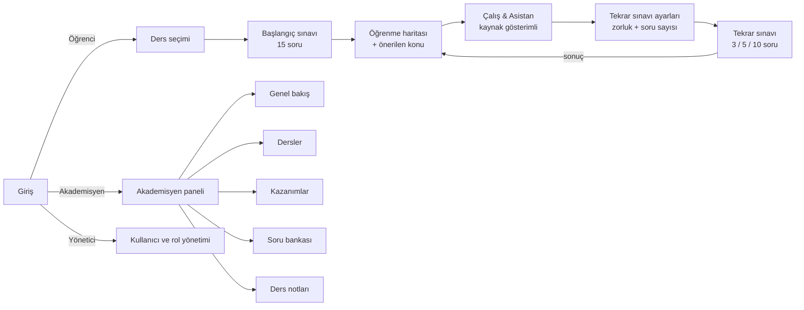
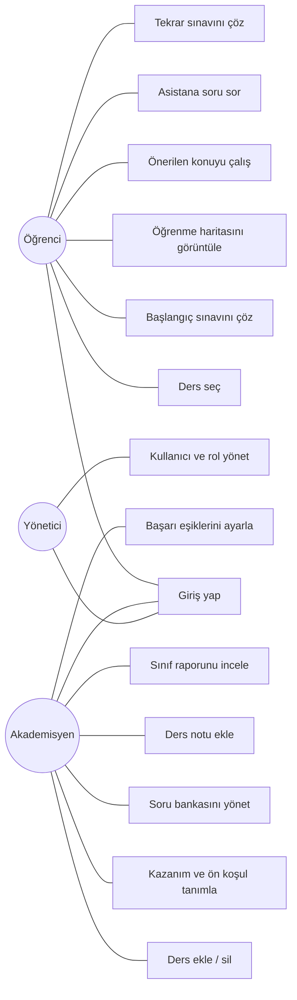
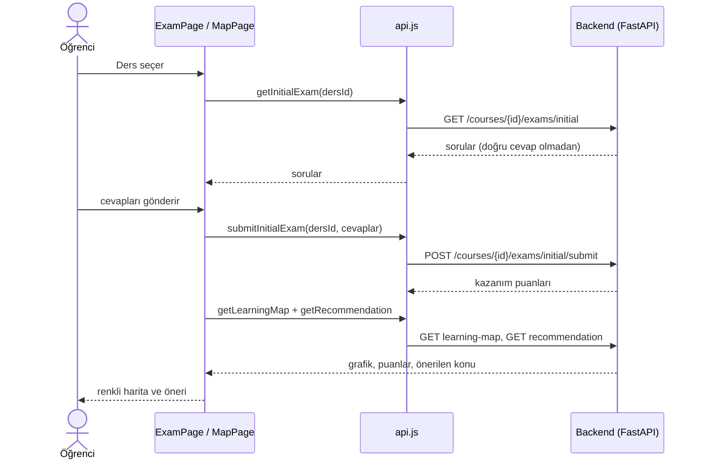
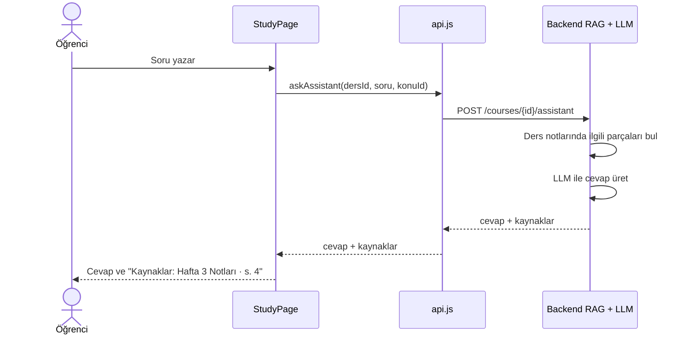
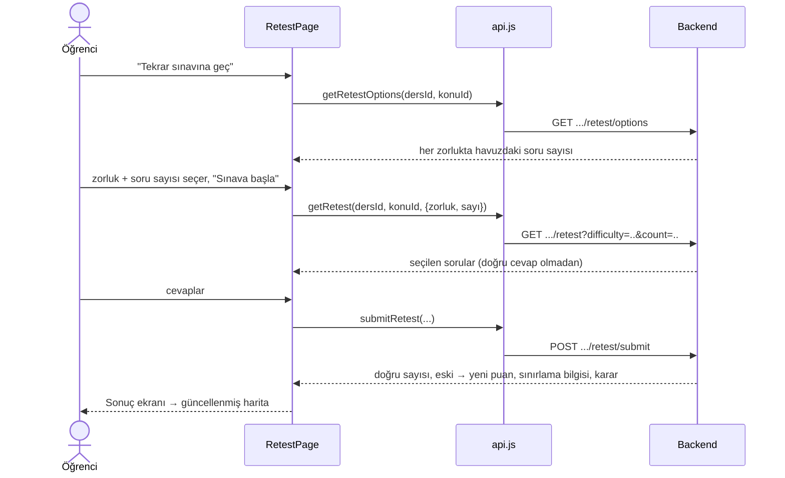

# StudyGraph AI – Arayüz Tasarımı (3. Kişi)

Bu belge, görev dağılımında 3. kişinin tasarım çıktılarını içerir:
wireframe'ler, Use Case ve Sequence diyagramlarına katkı, arayüz bileşen tasarımı.

---

## 1. Ekran akışı



---

## 2. Wireframe'ler

### Giriş
```
┌────────────────────────────────┐
│          StudyGraph AI          │
│  [Öğrenci][Akademisyen][Yönetici]│
│  E-posta  [_________________]   │
│  Şifre    [_________________]   │
│          [   Giriş yap   ]      │
└────────────────────────────────┘
```

### Öğrenme haritası
```
┌───────────────────────────────────────────────────────┐
│ Logo   Dersler  Öğrenme Haritam  Çalış & Asistan  Çıkış│
├───────────────────────────────────────────────────────┤
│ ▌Sıradaki önerilen konu: İç İçe Döngüler  [Çalış →]   │
├───────────────────────────────────────────────────────┤
│  [Değişkenler]──►[Diziler]────────────┐               │
│        └────────►[İç İçe D.]──►[Zaman K.]──►[Bubble]  │
│  ■ Yeterli  ■ Geliştirilmeli  ■ Eksik  □ Önerilen     │
├───────────────────────────────────────────────────────┤
│ İlerlemem:  Konu  ███████░░░  %70 (+37)               │
├───────────────────────────────────────────────────────┤
│ Ölçüm geçmişi (tablo)                                 │
└───────────────────────────────────────────────────────┘
```

### Sınav (başlangıç ve tekrar aynı bileşen)
```
┌───────────────────────────────────┐
│ ████████░░░░░░░  Soru 7 / 15       │
│ Soru metni                         │
│ [A] seçenek                        │
│ [B] seçenek                        │
│ [C] seçenek                        │
│ [D] seçenek                        │
│ [← Önceki]            [Sonraki →]  │
│        ● ● ● ● ● ● ◉ ○ ○ ○ ○        │
└───────────────────────────────────┘
```

### Tekrar sınavı ayarları
```
┌───────────────────────────────────────────┐
│ Zorluk                                    │
│ [Karışık][ Kolay ][ Orta ][ Zor ]         │
│  havuzda 10   3       4      3            │
│ Soru sayısı                               │
│ [ 3 soru ][ 5 soru ][ 10 soru ]           │
│ ───────────────────────────────────────── │
│ 5 soru · Karışık · ~4 dk   [Sınava başla] │
└───────────────────────────────────────────┘
```

### Çalış & Asistan
```
┌───────────────────────────────────────────┐
│ Konu: [İç İçe Döngüler ▼]  [Tekrar sınavı →]│
│ ┌───────────────────────────────────────┐ │
│ │                 [Kullanıcı sorusu]    │ │
│ │ [Asistan cevabı                    ]  │ │
│ │ [Kaynaklar: Hafta 3 Notları · s. 4 ]  │ │
│ └───────────────────────────────────────┘ │
│ [Sorunu yaz…                    ][Gönder] │
└───────────────────────────────────────────┘
```

### Akademisyen paneli
```
┌──────────────────────────────────────────────┐
│ Akademisyen Paneli            Ders: [BİM201▼]│
│ Genel Bakış | Dersler | Kazanımlar | Soru B. | Notlar │
├──────────────────────┬───────────────────────┤
│ Yeni ekleme formu    │ Mevcut kayıtlar listesi│
│ [alanlar]            │ ... [Sil]             │
│ [Ekle]               │ ... [Sil]             │
└──────────────────────┴───────────────────────┘
```

---

## 3. Bileşen tasarımı

```
App  (hangi ekranın gösterileceği, oturum, seçili ders ve konu)
├── LoginPage
├── Header  (role göre menü)
├── CoursesPage
├── ExamPage ─────────► Quiz
├── MapPage ──────────► LearningGraph
├── StudyPage  (asistan sohbeti, kaynak gösterimi)
├── RetestPage ───────► Quiz
├── InstructorPage
│   ├── ClassOverview   (sınıf raporu, bireysel ilerleme, eşikler)
│   ├── CourseManager
│   ├── OutcomeManager ─► LearningGraph
│   ├── QuestionManager
│   └── MaterialManager
└── AdminPage  (kullanıcı, rol, yetki matrisi)

api/api.js         → tüm veri istekleri (sahte mod / gerçek backend)
api/learningLogic.js → demo modunda puanlama, öneri, döngü kontrolü
api/mockData.js    → örnek veri
```

**Tasarım kararları**

| Karar | Gerekçe |
|---|---|
| Ekranlar veriyi yalnızca `api.js` üzerinden ister | Backend hazır olunca sadece bu dosya değişir; ekranlar etkilenmez (bağımlılığın tek noktada toplanması). |
| `Quiz` bileşeni iki sınavda ortak | Aynı davranış iki yerde tekrar yazılmaz; düzeltme tek yerde yapılır. |
| `LearningGraph` öğrenci ve akademisyen ekranında ortak | Öğrenci puanlarla, akademisyen puansız görür; çizim kodu bir kez yazılır. |
| Grafik ek kütüphane olmadan SVG ile çizildi | Bağımlılık sayısı düşük kalır, ön koşul sütunları (derinlik) kontrol altında. |
| Zorluk ve soru sayısı sadece tekrar sınavında seçilebilir | Başlangıç sınavı herkes için aynı ölçü olmalı; aksi hâlde harita güvenilir olmaz. |
| Sadece kolay sorularla girilen tekrar sınavı konuyu "yeterli" yapamaz | Öğrencinin kolay soru seçerek haritayı yapay olarak yeşile boyamasını engeller; puan en fazla eşiğin 1 altına sayılır. |
| "Karışık" zorlukta sorular kolay–orta–zor sırasıyla dengeli seçilir | Kısa sınavda bile her zorluktan soru gelir. |
| Doğru cevaplar sınav ekranına gönderilmez | Tarayıcıdan cevabın görülmesini engeller; puanlama sunucuda yapılır. |
| Menüler role göre gösterilir | Kullanıcı yetkisi olmayan ekranı görmez. Asıl yetki kontrolü backend'de. |
| Mobil uyum CSS medya sorgularıyla | Öğrenci telefondan sınav çözebilir, sohbet edebilir. |

---

## 4. Use Case diyagramına katkı (arayüz tarafı)



---

## 5. Sequence diyagramları

### Başlangıç sınavından haritaya


### Asistan (RAG) ile çalışma


### Tekrar sınavı ve harita güncellemesi


> Not: Uç nokta yolları arayüz tarafının önerisidir; backend ile birlikte kesinleştirilmelidir.
