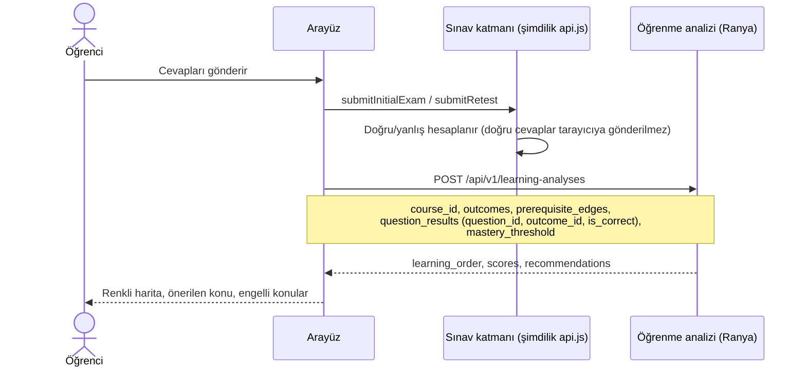

# StudyGraph AI – Arayüz ve Backend Entegrasyonu

**Durum (24.11.2026):** Öğrenme analizi entegrasyonu tamamlandı ve test edildi.
Diğer servisler backend'de henüz olmadığı için örnek veriyle çalışıyor.

## 1. Neler bağlı?

| Özellik | Kaynak | Durum |
|---|---|---|
| Kazanım puanları, öğrenme sırası, öneriler, engelli konular | Ranya'nın backend'i: `POST /api/v1/learning-analyses` | **Bağlı** |
| Backend çalışıyor mu kontrolü | `GET /api/v1/health` | **Bağlı** |
| Giriş, dersler, sınav soruları, soru bankası, notlar, asistan, raporlar, kullanıcılar | Örnek veri (`src/api/mockData.js`) | Backend servisi yok, bekleniyor |

Harita ekranının sağ üstünde analizin nereden geldiği yazar:
**"Analiz: backend"** (yeşil) ya da **"Analiz: yerel (backend kapalı)"**.
Backend kapalıysa uygulama bozulmaz; aynı kurallarla tarayıcıda hesaplar.

## 2. Nasıl çalıştırılır?

İki terminal gerekir.

**Terminal 1 – Backend** (Ranya'nın `feature/backend-foundation` dalı):
```
cd backend
pip install -r requirements.txt
uvicorn app.main:app --port 8000
```

**Terminal 2 – Arayüz:**
```
cd FRONTEND
npm install
npm run dev
```

Tarayıcıda `http://localhost:5173` açılır. Vite, `/api` ile başlayan istekleri
otomatik olarak `http://localhost:8000` adresine yönlendirir (`vite.config.js`),
bu yüzden backend'de CORS ayarı gerekmez.

**Entegrasyon testi** (backend açıkken): `npm run test:entegrasyon`

## 3. Veri akışı



Eşleştirme:

| Arayüz | Backend |
|---|---|
| kazanım `name` | `title` |
| `prerequisites: ['k1']` (k3 için) | `{ outcome_id: 'k3', prerequisite_id: 'k1' }` |
| akademisyenin "Yeterli" eşiği | `mastery_threshold` |
| `completed` | Yeşil, tamamlandı |
| `review` / `study` | Önerilebilir konu (ön koşulları tamam) |
| `blocked` | Ön koşulu eksik, önerilmez |

Her kazanım için **en son ölçümün** soru sonuçları gönderilir (başlangıç sınavı
ya da o konunun son tekrar sınavı).

## 4. Test sonuçları

Ranya'nın `LearningAnalysisService` kodu, FastAPI rotasıyla aynı JSON giriş/çıkışını
kullanan bir test sunucusunda çalıştırıldı. (Test ortamında FastAPI kurulamadığı için
Pydantic doğrulama katmanı bu testte devre dışıydı; analiz mantığı Ranya'nın gerçek kodudur.)

| Kontrol | Sonuç |
|---|---|
| Health endpoint | Geçti |
| İstek sözleşme formatında (15 sonuç, 6 ön koşul ilişkisi) | Geçti |
| Harita backend analiziyle geliyor | Geçti |
| Puanlar backend hesabı (k1 %100, k3 %0) | Geçti |
| Durumlar: İç İçe Döngüler `review`, Bubble Sort `blocked` | Geçti |
| Öneri: İç İçe Döngüler | Geçti |
| Kolay sınav sınırı backend sonucuna uygulanıyor | Geçti |
| Sınırlı konunun bağımlısı `blocked` kalıyor | Geçti |
| Orta sınav sonrası konu `completed`, öneri Zaman Karmaşıklığı | Geçti |
| Bubble Sort engelli kalıyor | Geçti |
| Backend kapalıyken yerel hesap aynı öneriyi veriyor | Geçti |

Tarayıcı testi: harita "Analiz: backend" gösterdi; sınav → harita → tekrar sınavı
akışında tüm analizler backend'den geldi.

**Testin bulduğu hata:** İlk sürümde soru sonuçlarında `outcome_id` alanı eksikti;
backend isteği reddetti. Düzeltildi.

## 5. Ekipçe karar verilmesi gerekenler

1. **Zorluk bilgisi:** Backend soruların zorluğunu bilmiyor. "Sadece kolay sorularla
   konu yeterli sayılmaz" kuralı şimdilik arayüzde uygulanıyor. Kalıcı çözüm için
   `question_results` içine `difficulty` alanı eklenip kuralın backend'e taşınması önerilir.
2. **Doğru/yanlış hesabı:** Sözleşmeye göre bu iş sınav sisteminin. Şu an `api.js`
   içindeki sınav katmanında yapılıyor (doğru cevaplar ekrana gönderilmiyor). Sınav
   servisi yazılınca bu katman ona bağlanacak ve `is_correct` sunucuda üretilecek.
3. **Kalıcı kayıt:** Analiz endpoint'i veritabanına yazmıyor; ilerleme geçmişi şimdilik
   tarayıcıda tutuluyor.
4. **Kimlikler:** Ders kimliği backend'e metin (`"1"`) olarak gidiyor; veritabanı
   tasarımıyla uyumlu hâle getirilmeli.
