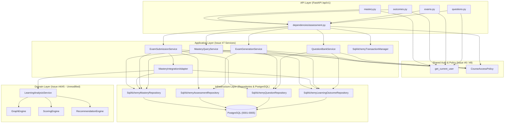
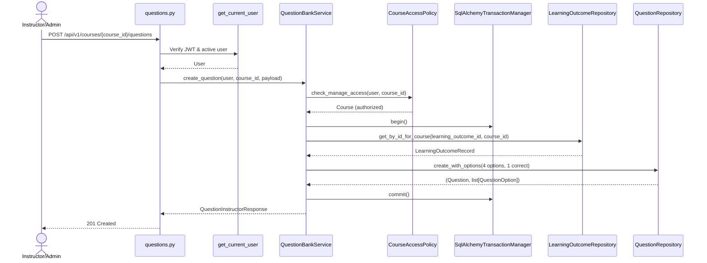
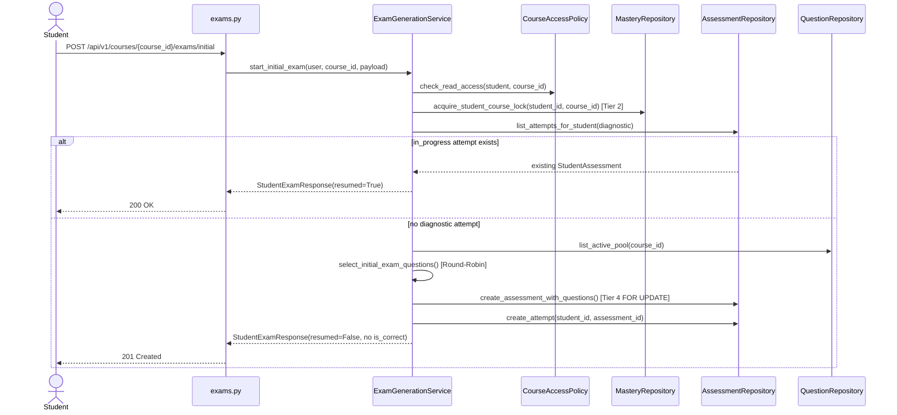
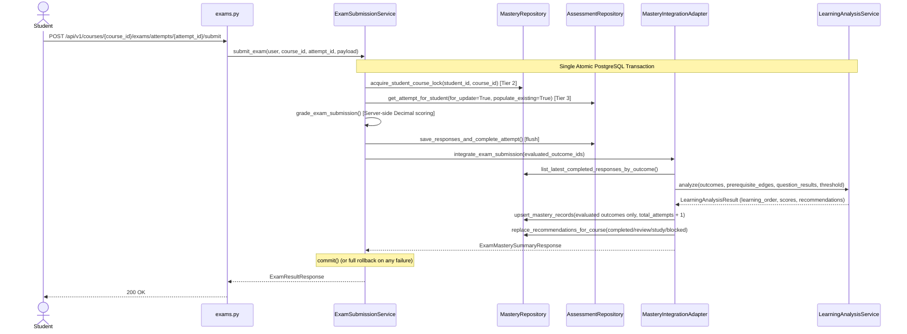
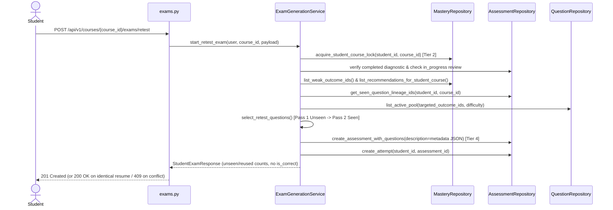
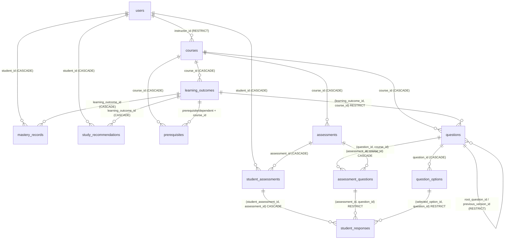

# StudyGraph AI — Soru Bankası, Başlangıç ve Tekrar Sınavları Mimarisi (Issue #7)

> **Kapsam:** Issue #7 — Soru Bankası, Başlangıç Sınavı, Tekrar Sınavı, Sunucu Tarafı Puanlama ve Issue #5 Başarı Motoru Entegrasyonu
> **Branch:** `feature/question-bank-exams` (taban: `feature/rag-system` / `7f13292`)
> **Veritabanı Migration:** `0005_create_assessment_tables` (PostgreSQL 15+/18.1, SQLAlchemy 2.0, Alembic)

---

## 1. Amaç ve Kapsam

Issue #7 modülü, StudyGraph AI platformunda:

- Öğrenme kazanımlarıyla (`learning_outcomes`) ilişkilendirilmiş çoktan seçmeli soru bankasının akademisyen ve yöneticiler tarafından güvenli biçimde yönetilmesini,
- Öğrenciler için ders kazanımlarını dengeli biçimde ölçen başlangıç sınavlarının (`diagnostic`, varsayılan 15 soru) oluşturulmasını,
- Öğrenci cevaplarının sunucu tarafında doğrulanıp puanlanmasını ve kalıcı olarak saklanmasını,
- Sınav sonuçlarının başka bir ekip üyesinin geliştirdiği gerçek **Issue #5 (`LearningAnalysisService`)** başarı hesaplama ve öneri motoruna atomik olarak aktarılmasını,
- Eksik ve ön koşulları tamamlanmış (`status == "review"`) kazanımlara yönelik, mümkün olduğunca daha önce görülmemiş soru soylarını seçen tekrar sınavlarının (`review`, varsayılan 5 soru) uygulanmasını sağlar.

> **Paylaşımlı Altyapı Notu:** `learning_outcomes` ve `prerequisites` ORM modelleri (`LearningOutcomeRecord`, `Prerequisite`) ve `LearningOutcomeRepository`, Issue #4/#5 ve Issue #7'nin ortak veritabanı altyapısı olarak `docs/DATABASE_DESIGN.md` şemasına uygun biçimde oluşturulmuştur. Issue #4/#5'in bellek içi domain sınıfları (`LearningOutcome`, `GraphEngine`, `ScoringEngine`, `RecommendationEngine`, `LearningAnalysisService`) **değiştirilmeden** doğrudan yeniden kullanılmaktadır.

---

## 2. Katmanlı Mimari

Sistem dört katmanda yapılandırılmıştır:

1. **API / Presentation Katmanı (`app/api/`):** `questions.py`, `exams.py`, `outcomes.py`, `mastery.py` ve `dependencies/assessment.py`. Yalnızca HTTP istek/yanıt, `SanitizedValidationRoute`, JWT kimlik doğrulama (`get_current_user`), request-scoped DI ve `translate_assessment_error` hata eşlemesinden sorumludur; SQL veya iş kuralı içermez.
2. **Application / Service Katmanı (`app/services/`):** `QuestionBankService`, `ExamGenerationService`, `ExamSubmissionService`, `MasteryIntegrationAdapter`, `MasteryQueryService`, `SqlAlchemyTransactionManager`. Yetkilendirme (`CourseAccessPolicy`), transaction sınırları (Unit of Work), saf soru seçim/puanlama algoritmaları ve Issue #5 adaptörünü yönetir; FastAPI/HTTP bağımlılığı yoktur.
3. **Domain Katmanı (`app/domain/` — Issue #4/#5):** `LearningOutcome`, `GraphEngine`, `ScoringEngine`, `RecommendationEngine` ve `LearningAnalysisService` doğrudan çağrılır; HTTP loopback yapılmaz.
4. **Infrastructure / Persistence Katmanı (`app/models/`, `app/repositories/`):** 10 SQLAlchemy 2.0 ORM modeli, Alembic `0005_create_assessment_tables` migration'ı ve 4 Protocol + SQLAlchemy repository'si (`LearningOutcomeRepository`, `QuestionRepository`, `AssessmentRepository`, `MasteryRepository`).

---

## 3. UML ve Mermaid Diyagramları

### 3.1. Component Diagram

### 3.2. Class Diagram

```mermaid
classDiagram
    direction TB

    class TransactionManager {
        <<Protocol>>
        +begin() AbstractContextManager
    }

    class MasteryIntegrator {
        <<Protocol>>
        +integrate_exam_submission(student_id, course_id, evaluated_outcome_ids, assessed_at) ExamMasterySummaryResponse
    }

    class LearningOutcomeRepository {
        <<Protocol>>
        +list_by_course(course_id) list
        +list_prerequisites_by_course(course_id) list
        +add_prerequisite(course_id, prerequisite_outcome_id, dependent_outcome_id) Prerequisite
    }

    class QuestionRepository {
        <<Protocol>>
        +list_by_course(course_id, learning_outcome_id, active_only) list
        +list_active_pool(course_id, learning_outcome_ids, difficulty_level) list
        +create_with_options(...) tuple
        +update_or_version(...) tuple
        +delete_or_archive(course_id, question_id) bool
    }

    class AssessmentRepository {
        <<Protocol>>
        +create_assessment_with_questions(...) tuple
        +create_attempt(student_id, assessment_id, course_id) StudentAssessment
        +get_attempt_for_student(attempt_id, student_id, course_id, for_update) StudentAssessment
        +save_responses_and_complete_attempt(...) tuple
        +get_seen_question_lineage_ids(student_id, course_id) set
    }

    class MasteryRepository {
        <<Protocol>>
        +acquire_student_course_lock(student_id, course_id) None
        +list_weak_outcome_ids(student_id, course_id, mastery_threshold) list
        +upsert_mastery_records(student_id, course_id, updates, assessed_at) list
        +replace_recommendations_for_course(student_id, course_id, recommendations) list
        +list_latest_completed_responses_by_outcome(student_id, course_id) list
    }

    class QuestionBankService {
        +list_questions(user, course_id, ...) list
        +get_question(user, course_id, question_id) QuestionInstructorResponse
        +create_question(user, course_id, payload) QuestionInstructorResponse
        +update_question(user, course_id, question_id, payload) QuestionUpdateResponse
        +delete_question(user, course_id, question_id) QuestionDeleteResponse
    }

    class ExamGenerationService {
        +start_initial_exam(user, course_id, payload) StudentExamResponse
        +start_retest_exam(user, course_id, payload) StudentExamResponse
        +get_student_exam(user, course_id, attempt_id) StudentExamResponse
    }

    class ExamSubmissionService {
        +submit_exam(user, course_id, attempt_id, payload) ExamResultResponse
        +get_exam_result(user, course_id, attempt_id) ExamResultResponse
        +list_exam_history(user, course_id, limit, offset) list
    }

    class MasteryIntegrationAdapter {
        +integrate_exam_submission(...) ExamMasterySummaryResponse
    }

    class MasteryQueryService {
        +list_course_outcomes(user, course_id) list
        +get_student_mastery_map(user, course_id) CourseMasteryMapResponse
        +get_student_recommendations(user, course_id) CourseRecommendationsResponse
    }

    MasteryIntegrationAdapter ..|> MasteryIntegrator
    QuestionBankService --> QuestionRepository
    QuestionBankService --> LearningOutcomeRepository
    QuestionBankService --> TransactionManager
    ExamGenerationService --> AssessmentRepository
    ExamGenerationService --> QuestionRepository
    ExamGenerationService --> LearningOutcomeRepository
    ExamGenerationService --> MasteryRepository
    ExamGenerationService --> TransactionManager
    ExamSubmissionService --> AssessmentRepository
    ExamSubmissionService --> QuestionRepository
    ExamSubmissionService --> MasteryRepository
    ExamSubmissionService --> MasteryIntegrator
    ExamSubmissionService --> TransactionManager
    MasteryIntegrationAdapter --> LearningOutcomeRepository
    MasteryIntegrationAdapter --> MasteryRepository
    MasteryQueryService --> LearningOutcomeRepository
    MasteryQueryService --> MasteryRepository
```

### 3.3. Sequence Diagram — Akademisyenin Soru Eklemesi

### 3.4. Sequence Diagram — Başlangıç Sınavı Oluşturulması

### 3.5. Sequence Diagram — Sınav Teslimi ve `LearningAnalysisService` Entegrasyonu

### 3.6. Sequence Diagram — Tekrar Sınavı Oluşturulması

### 3.7. ER Diagram (Issue #7 Tabloları ve Mevcut Tablolarla İlişkileri)

---

## 4. Çekirdek Algoritmalar ve İş Kuralları

- **Başlangıç Sınavı (`select_initial_exam_questions`):** Yalnızca `is_active=True` sorular alınır, `COALESCE(root_question_id, id)` ile soy ağacı tekilleştirilir, kazanımlar müfredat sırasıyla (`order_index ASC, id ASC`) dolaşılarak Round-Robin dağıtım yapılır (varsayılan 15 soru). Havuzu erken tükenen kazanımın kontenjanı diğer uygun kazanımlardan tamamlanır; hiç sorusu olmayan veya kontenjan dışında kalan kazanımlar `uncovered_outcome_ids` içinde raporlanır (başarısız sayılmaz).
- **Tekrar Sınavı (`select_retest_questions`):** Yalnızca tamamlanmış başlangıç sınavından sonra, `mastery_score < threshold` (70.0) **ve** `study_recommendations.status == "review"` olan (başarılı, `blocked` veya değerlendirilmemiş olmayan) kazanımlar hedeflenir. `AssessmentRepository.get_seen_question_lineage_ids` öğrencinin başlattığı tüm oturumlardaki `assessment_questions` kayıtlarının soy kimliklerini (`COALESCE(root_question_id, id)`) çıkarır; Tur 1'de yalnızca görülmemiş soylar, yetmezse Tur 2'de görülmüş soylar tekrarsız seçilir (varsayılan 5 soru). Zorluk filtresi (`difficulty`) kesin uygulanır.
- **Sunucu Tarafı Puanlama (`grade_exam_submission`):** `Decimal` + `ROUND_HALF_UP` ile `score = (earned_points / total_possible_points) * 100` (0–100, 2 ondalık) hesaplanır. Sınava atanmış orijinal soru versiyonunun `Question.points` ve `QuestionOption.is_correct` değerleri kullanılır; boş cevaplar `selected_option_id=None`, `is_correct=False`, `score_earned=0.0` olarak kaydedilir.
- **Soru Versiyonlama ve Tarihsel Bütünlük:** Herhangi bir `assessment_questions` satırına girmiş soru `ON DELETE RESTRICT` ile korunur. Düzenleme talebinde eski soru `is_active=False`, `archived_at=now()` yapılır ve aynı `root_question_id` / `previous_version_id` soy ağacıyla `version_number + 1` oluşturulur; silme talebinde arşivlenir (`archived=True`).

---

## 5. Transaction Yönetimi, Concurrency ve Lock Ordering

Tüm Issue #7 repository'leri bağımsız `commit()` yapmaz (caller-owned Unit of Work — `SqlAlchemyTransactionManager`). Deadlock'ları önlemek için sabit bir 4 katmanlı kilit sırası uygulanır:

| Katman | Kilit Mekanizması | Kapsam |
| --- | --- | --- |
| **Tier 1** | `pg_advisory_xact_lock(1001, course_id)` (2-arg `int4`) | `LearningOutcomeRepository.add_prerequisite` — eşzamanlı ön koşul eklemelerinde döngü önleme |
| **Tier 2** | `pg_advisory_xact_lock((student_id << 32) \| course_id)` (1-arg `bigint`) | `MasteryRepository.acquire_student_course_lock` — eşzamanlı sınav başlatma, sınav teslimi ve mastery upsert'lerini öğrenci+ders bazında serileştirme |
| **Tier 3** | `SELECT ... FROM student_assessments WHERE id = :id FOR UPDATE` (`populate_existing=True`) | `AssessmentRepository.get_attempt_for_student` — eşzamanlı çift teslimi `AttemptAlreadyFinalizedError` ile engelleme |
| **Tier 4** | `SELECT ... FROM questions ... ORDER BY id ASC FOR UPDATE` | `QuestionRepository` & `AssessmentRepository.create_assessment_with_questions` — eşzamanlı soru düzenleme ve sınava atama yarışını serileştirme |

---

## 6. SOLID Prensipleri ve Design Pattern Uygulamaları

| Prensip / Pattern | Somut Kod Örneği |
| --- | --- |
| **SRP (Single Responsibility)** | Saf seçim (`select_initial_exam_questions`, `select_retest_questions`), saf puanlama (`grade_exam_submission`), soru yönetimi (`QuestionBankService`), sınav oluşturma (`ExamGenerationService`), sınav teslimi (`ExamSubmissionService`), Issue #5 adaptasyonu (`MasteryIntegrationAdapter`) ve salt-okunur sorgulama (`MasteryQueryService`) ayrı sınıflarda/fonksiyonlardadır. |
| **OCP (Open/Closed)** | `ExamSubmissionService` hem `diagnostic` hem `review` sınavlarını tek teslim akışında işler; yeni değerlendirme türleri (`practice`, `final`) puanlama veya teslim servisini değiştirmeden desteklenir. |
| **LSP (Liskov Substitution)** | `SqlAlchemy*Repository` sınıfları ve birim testlerdeki `_Fake*Repository` sınıfları ilgili `Protocol` sözleşmelerinin yerine davranış bozulmadan geçer. |
| **ISP (Interface Segregation)** | Tek dev bir repository yerine `LearningOutcomeRepository`, `QuestionRepository`, `AssessmentRepository`, `MasteryRepository`, `TransactionManager` ve `MasteryIntegrator` dar kapsamlı Protocol arayüzleri olarak ayrılmıştır. |
| **DIP (Dependency Inversion)** | Tüm servisler somut SQLAlchemy sınıflarına değil `Protocol` arayüzlerine bağımlıdır (`app/services/*.py`); somut bağlantılar yalnızca composition root olan `app/api/dependencies/assessment.py` içinde kurulur. |
| **Repository Pattern** | `app/repositories/{learning_outcome,question,assessment,mastery}_repository.py` tüm SQLAlchemy/PostgreSQL sorgularını ve kilitlerini soyutlar. |
| **Adapter Pattern** | `MasteryIntegrationAdapter` (`app/services/mastery_integration.py`) DB modellerini Issue #5 `LearningAnalysisService.analyze(...)` domain tiplerine (`LearningOutcome`, `QuestionResult`) uyarlar. |
| **Dependency Injection** | FastAPI `Depends(...)` zinciri (`app/api/dependencies/assessment.py`) aynı request-scoped `Session` ile tüm servis ve repository'leri kurar; `ExamGenerationService` enjekte edilebilir `rng_factory` kabul eder. |
| **Unit of Work** | `TransactionManager` / `SqlAlchemyTransactionManager` (`app/services/question_bank_service.py`) çoklu repository çağrısını tek atomik commit/rollback sınırında toplar. |

---

## 7. Bilinen Sınırlamalar

1. **Ders, kayıt ve kazanım oluşturma API'leri:** `courses`, `course_enrollments`, `learning_outcomes` ve `prerequisites` kayıtlarını HTTP üzerinden oluşturan yönetim endpoint'leri Issue #7 kapsamında değildir (ders/graf yönetimi kapsamı; ayrı entegrasyon görevi olarak planlanmıştır).
2. **Frontend kolay sınav tavanı (69 puan):** `origin/feature/frontend` yerel `learningLogic.js` dosyasındaki kolay sınav puan sınırı backend `ScoringEngine` üzerinde uygulanmamaktadır; çözüm için ekip kararı beklenmektedir.
3. **Canlı frontend bağlantısı:** Backend kanonik `/api/v1` API'si tamamlanmış ve test edilmiştir; React arayüzü (`origin/feature/frontend`) henüz `USE_MOCK = true` modundadır.

> **Remediation Notu (M1–M4, L1–L2):** Final Code Review bulgularının tamamı giderilmiştir: soru listeleme filtre/pagination işlemleri SQL seviyesine indirilmiş, başlangıç ve tekrar sınavı metadata'sı katı dahili Pydantic şemalarıyla doğrulanmış, `GET /recommendations` ve tekrar sınavı uygunluk kontrolü güncel ön koşul grafı üzerinden salt-okunur `compute_live_recommendations` ile birleştirilmiş ve beklenmeyen `ValueError`/iç hatalar hassas bilgi sızdırmadan loglanarak `HTTP 500` olarak ayrıştırılmıştır.
