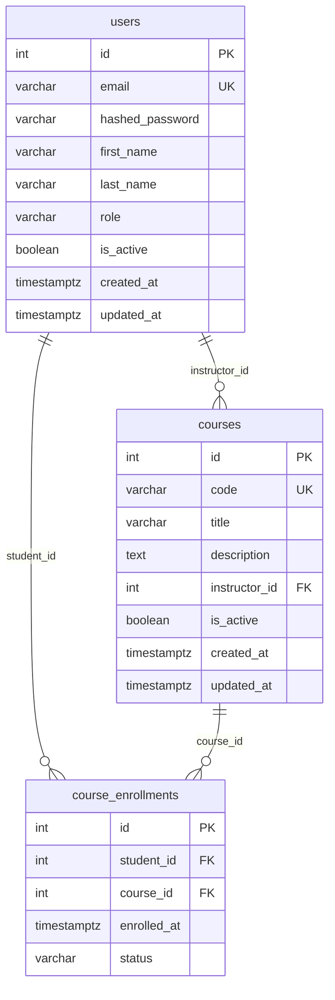
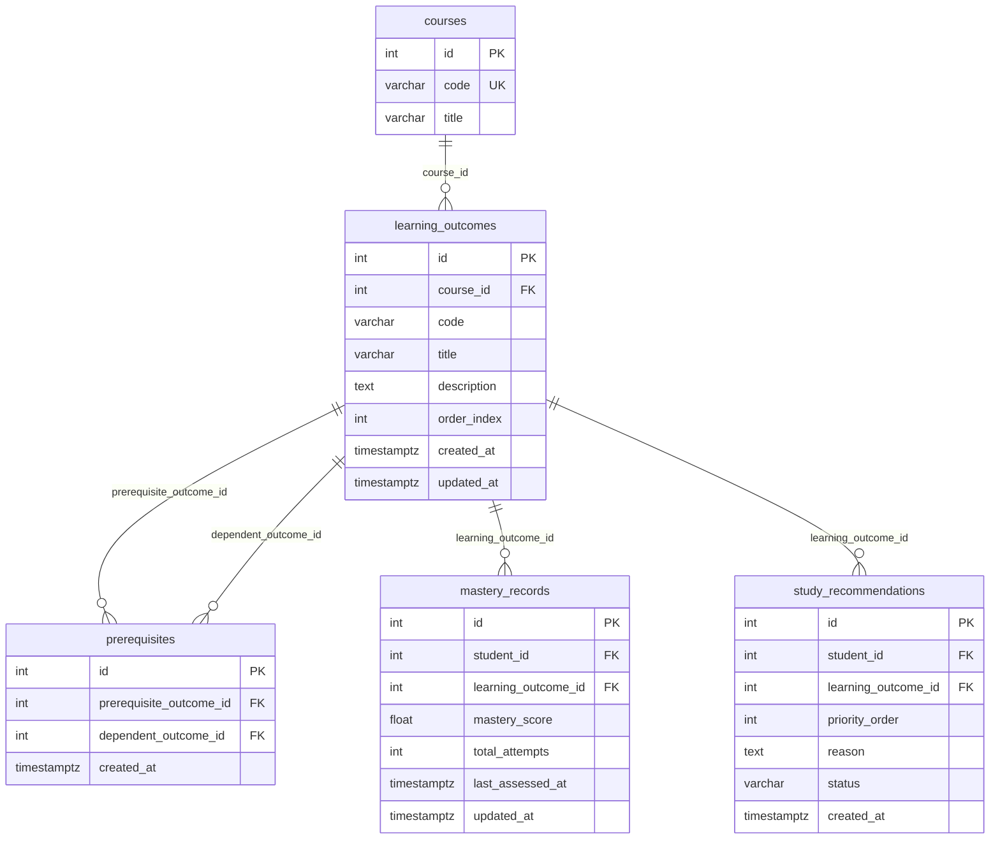
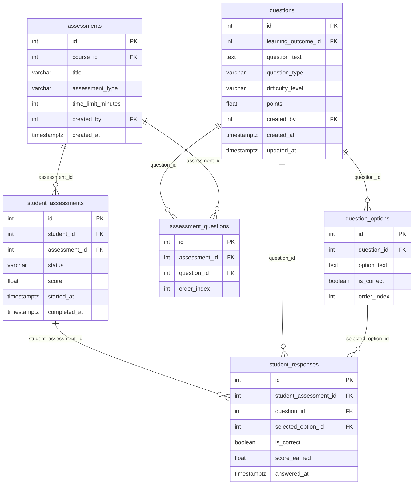
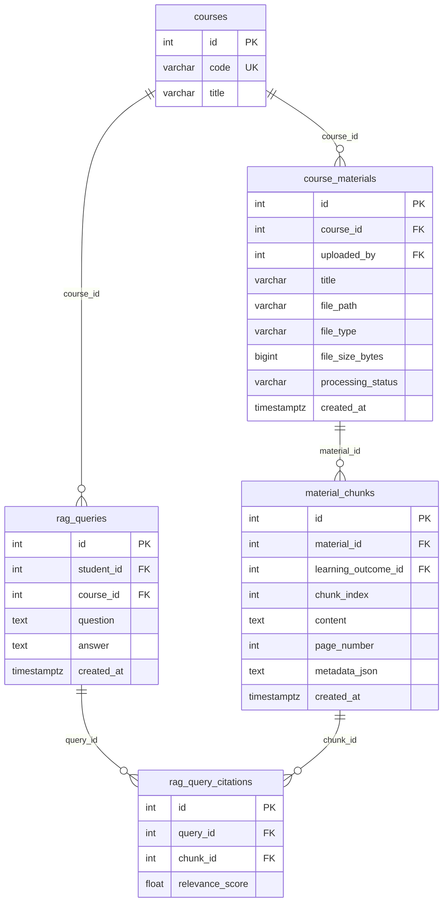

# StudyGraph AI — Veritabanı Tasarımı ve ER Diyagramı

> **Issue:** #2 — Database Design & ER Diagram
> **Branch:** `feature/database-design`
> **Tarih:** Kasım 2026
> **Durum:** Tasarım tamamlandı — ORM implementasyonu bekleniyor

---

## 1. Genel Bakış

Bu belge, StudyGraph AI projesinin ilişkisel veritabanı tasarımını kapsamaktadır. Tasarım aşağıdaki modüllerle tam uyumlu olacak şekilde hazırlanmıştır:

| Issue | Modül                                   | Desteklenen Tablolar                                                          |
| ----- | --------------------------------------- | ----------------------------------------------------------------------------- |
| #6    | Kimlik Doğrulama & Yetkilendirme       | `users`, `courses`, `course_enrollments`                                     |
| #7    | Soru Bankası, Sınavlar & Yeterlilik    | `questions`, `question_options`, `assessments`, `assessment_questions`, `student_assessments`, `student_responses`, `mastery_records`, `study_recommendations` |
| #8    | Ders Materyalleri & RAG Asistanı       | `course_materials`, `material_chunks`, `rag_queries`, `rag_query_citations`  |

Ayrıca tüm modüllerin temelini oluşturan **Öğrenme Grafiği** bileşeni için:

- `learning_outcomes` — Öğrenme kazanımları / çıktıları
- `prerequisites` — Yönlü ön koşul ilişkileri (graf kenarları)

---

## 2. Tasarım Prensipleri

### 2.1. Teknoloji Seçimi

| Bileşen     | Teknoloji                                   |
| ----------- | ------------------------------------------- |
| Veritabanı  | PostgreSQL 15+                              |
| ORM         | SQLAlchemy 2.0 (Declarative Mapping)        |
| Migration   | Alembic                                     |
| Backend     | Python 3.13, FastAPI                        |

> **Not:** Tablo ve alan isimleri SQLAlchemy 2.0 ORM modelleriyle birebir uyumlu olacak şekilde tasarlanmıştır. `snake_case`, çoğul tablo isimleri ve `id` birincil anahtar standardı kullanılmıştır.

### 2.2. Genel Kurallar

- Tüm tablolarda **birincil anahtar:** `id` (SERIAL / BIGSERIAL, otomatik artan).
- Tarih/saat alanlarında **`TIMESTAMP WITH TIME ZONE (TIMESTAMPTZ)`** kullanılmaktadır.
- Metin uzunlukları tasarıma göre `VARCHAR(n)` ile sınırlandırılmış, uzun içerik alanları `TEXT` olarak belirlenmiştir.
- Silme davranışları (`ON DELETE`) her yabancı anahtar için açıkça tanımlanmıştır.
- Teklik kısıtlamaları (`UNIQUE`) veri bütünlüğünü güvence altına almaktadır.

---

## 3. Tablo Tanımları

---

### 3.1. `users` — Kullanıcılar

Sisteme kayıtlı tüm kullanıcıları (öğrenci, akademisyen, yönetici) tek tabloda tutar. Rol bazlı yetkilendirme `role` alanı ile sağlanır.

**Issue #6 (Authentication & Authorization)** ile doğrudan ilişkilidir.

| Alan               | Veri Tipi              | Kısıtlamalar                          | Açıklama                                           |
| ------------------ | ---------------------- | ------------------------------------- | -------------------------------------------------- |
| `id`               | SERIAL                 | PRIMARY KEY                           | Otomatik artan birincil anahtar                    |
| `email`            | VARCHAR(255)           | UNIQUE, NOT NULL                      | Kullanıcı e-posta adresi (oturum açma kimliği)     |
| `hashed_password`  | VARCHAR(255)           | NOT NULL                              | bcrypt ile hashlenmiş parola                       |
| `first_name`       | VARCHAR(100)           | NOT NULL                              | Kullanıcının adı                                   |
| `last_name`        | VARCHAR(100)           | NOT NULL                              | Kullanıcının soyadı                                |
| `role`             | VARCHAR(20)            | NOT NULL, CHECK IN ('student','instructor','admin') | Kullanıcı rolü                        |
| `is_active`        | BOOLEAN                | NOT NULL, DEFAULT TRUE                | Hesap aktiflik durumu (soft-disable desteği)       |
| `created_at`       | TIMESTAMPTZ            | NOT NULL, DEFAULT NOW()               | Kayıt oluşturulma zamanı                           |
| `updated_at`       | TIMESTAMPTZ            | NOT NULL, DEFAULT NOW()               | Son güncelleme zamanı                              |

**İndeksler:** `email` (UNIQUE INDEX otomatik oluşur), `role` (sorgu performansı için önerilir).

---

### 3.2. `courses` — Dersler

Sistemdeki dersleri tanımlar. Her dersin bir akademisyen sahibi (`instructor_id`) vardır.

| Alan            | Veri Tipi    | Kısıtlamalar                       | Açıklama                                     |
| --------------- | ------------ | ---------------------------------- | -------------------------------------------- |
| `id`            | SERIAL       | PRIMARY KEY                        | Otomatik artan birincil anahtar              |
| `code`          | VARCHAR(50)  | UNIQUE, NOT NULL                   | Ders kodu (örn. `CENG301`)                  |
| `title`         | VARCHAR(200) | NOT NULL                           | Ders başlığı                                 |
| `description`   | TEXT         | NULLABLE                           | Ders açıklaması                              |
| `instructor_id` | INTEGER      | FK → `users.id` ON DELETE RESTRICT | Dersin sahibi akademisyen                    |
| `is_active`     | BOOLEAN      | NOT NULL, DEFAULT TRUE             | Dersin aktiflik durumu                       |
| `created_at`    | TIMESTAMPTZ  | NOT NULL, DEFAULT NOW()            | Kayıt oluşturulma zamanı                     |
| `updated_at`    | TIMESTAMPTZ  | NOT NULL, DEFAULT NOW()            | Son güncelleme zamanı                        |

> `ON DELETE RESTRICT`: Aktif dersi olan bir akademisyen silinemez. Önce ders devri veya devre dışı bırakma gerekir.

---

### 3.3. `course_enrollments` — Öğrenci Kayıtları

Öğrencilerin derslere kayıt bilgilerini tutar. `users` ve `courses` tabloları arasındaki **N:M** ilişkiyi çözer.

| Alan          | Veri Tipi   | Kısıtlamalar                          | Açıklama                                          |
| ------------- | ----------- | ------------------------------------- | ------------------------------------------------- |
| `id`          | SERIAL      | PRIMARY KEY                           | Otomatik artan birincil anahtar                   |
| `student_id`  | INTEGER     | FK → `users.id` ON DELETE CASCADE     | Kayıt olan öğrenci                                |
| `course_id`   | INTEGER     | FK → `courses.id` ON DELETE CASCADE   | Kaydedildiği ders                                 |
| `enrolled_at` | TIMESTAMPTZ | NOT NULL, DEFAULT NOW()               | Kayıt tarihi                                      |
| `status`      | VARCHAR(20) | NOT NULL, DEFAULT 'active', CHECK IN ('active','completed','dropped') | Kayıt durumu |

**Teklik Kısıtlaması:** `UNIQUE(student_id, course_id)` — Bir öğrenci aynı derse birden fazla kayıt yaptıramaz.

---

### 3.4. `learning_outcomes` — Öğrenme Kazanımları

Derslere ait öğrenme kazanımlarını / çıktılarını tanımlar. **Graph Engine**'in temel düğümleridir. `prerequisites` tablosu ile yönlü bir öğrenme grafı oluşturulur.

| Alan           | Veri Tipi    | Kısıtlamalar                         | Açıklama                                            |
| -------------- | ------------ | ------------------------------------ | --------------------------------------------------- |
| `id`           | SERIAL       | PRIMARY KEY                          | Otomatik artan birincil anahtar                     |
| `course_id`    | INTEGER      | FK → `courses.id` ON DELETE CASCADE  | Bağlı olduğu ders                                   |
| `code`         | VARCHAR(50)  | NOT NULL                             | Kazanım kodu (örn. `LO-01`)                        |
| `title`        | VARCHAR(255) | NOT NULL                             | Kazanım başlığı                                     |
| `description`  | TEXT         | NULLABLE                             | Kazanım açıklaması                                  |
| `order_index`  | INTEGER      | NOT NULL, DEFAULT 0                  | Önerilen çalışma sırası (görsel harita için)        |
| `created_at`   | TIMESTAMPTZ  | NOT NULL, DEFAULT NOW()              | Kayıt oluşturulma zamanı                            |
| `updated_at`   | TIMESTAMPTZ  | NOT NULL, DEFAULT NOW()              | Son güncelleme zamanı                               |

**Teklik Kısıtlaması:** `UNIQUE(course_id, code)` — Bir ders içinde kazanım kodları tekil olmalıdır.

---

### 3.5. `prerequisites` — Ön Koşul İlişkileri (Graf Kenarları)

Öğrenme kazanımları arasındaki yönlü ön koşul ilişkisini temsil eder. Bu tablo, **Graph Engine** modülü için yönlü asiklik grafın (DAG — Directed Acyclic Graph) kenar listesidir.

| Alan                       | Veri Tipi   | Kısıtlamalar                                    | Açıklama                                            |
| -------------------------- | ----------- | ----------------------------------------------- | --------------------------------------------------- |
| `id`                       | SERIAL      | PRIMARY KEY                                     | Otomatik artan birincil anahtar                     |
| `prerequisite_outcome_id`  | INTEGER     | FK → `learning_outcomes.id` ON DELETE CASCADE   | Önce öğrenilmesi gereken kazanım (kaynak düğüm)     |
| `dependent_outcome_id`     | INTEGER     | FK → `learning_outcomes.id` ON DELETE CASCADE   | Hedef kazanım (hedef düğüm)                         |
| `created_at`               | TIMESTAMPTZ | NOT NULL, DEFAULT NOW()                         | İlişkinin tanımlanma zamanı                         |

**Teklik Kısıtlaması:** `UNIQUE(prerequisite_outcome_id, dependent_outcome_id)` — Aynı iki kazanım arasında birden fazla kenar olamaz.

**Öz-Referans Kısıtlaması:** `CHECK(prerequisite_outcome_id != dependent_outcome_id)` — Bir kazanım kendi kendinin ön koşulu olamaz.

> **Döngü Kontrolü (Cycle Detection):** Veritabanı katmanı doğrudan döngü tespiti yapamaz. Bu nedenle her yeni ön koşul ilişkisi kaydedilmeden önce **uygulama katmanında (Application Layer)** DFS (Depth-First Search) veya BFS (Breadth-First Search) algoritması çalıştırılarak döngü kontrolü yapılmalıdır. Graph Engine modülü bu sorumluluğu üstlenir.

---

### 3.6. `questions` — Soru Bankası

Sisteme tanımlı tüm soruları içerir. Her soru belirli bir öğrenme kazanımına (`learning_outcome_id`) bağlıdır.

**Issue #7 (Question Bank & Exams)** ile doğrudan ilişkilidir.

| Alan                  | Veri Tipi   | Kısıtlamalar                                              | Açıklama                                            |
| --------------------- | ----------- | --------------------------------------------------------- | --------------------------------------------------- |
| `id`                  | SERIAL      | PRIMARY KEY                                               | Otomatik artan birincil anahtar                     |
| `learning_outcome_id` | INTEGER     | FK → `learning_outcomes.id` ON DELETE CASCADE             | Sorunun ölçtüğü öğrenme kazanımı                   |
| `question_text`       | TEXT        | NOT NULL                                                  | Soru metni                                          |
| `question_type`       | VARCHAR(30) | NOT NULL, DEFAULT 'multiple_choice', CHECK IN ('multiple_choice','true_false') | Soru türü |
| `difficulty_level`    | VARCHAR(20) | NOT NULL, DEFAULT 'medium', CHECK IN ('easy','medium','hard') | Zorluk seviyesi                               |
| `points`              | FLOAT       | NOT NULL, DEFAULT 1.0, CHECK > 0                          | Sorunun puan değeri                                 |
| `created_by`          | INTEGER     | FK → `users.id` ON DELETE SET NULL, NULLABLE              | Soruyu oluşturan kullanıcı                          |
| `created_at`          | TIMESTAMPTZ | NOT NULL, DEFAULT NOW()                                   | Kayıt oluşturulma zamanı                            |
| `updated_at`          | TIMESTAMPTZ | NOT NULL, DEFAULT NOW()                                   | Son güncelleme zamanı                               |

> `ON DELETE SET NULL` (created_by): Kullanıcı silinse dahi soru bankasındaki sorular korunur; `created_by` alanı NULL olur.

---

### 3.7. `question_options` — Soru Seçenekleri

Çoktan seçmeli soruların şıklarını tutar. Doğru cevap `is_correct = TRUE` ile işaretlenir.

**Veri Bütünlüğü Kuralı:** Her `question_id` için yalnızca bir `is_correct = TRUE` seçenek bulunmalıdır. Bu kural uygulama katmanında (servis katmanında) zorunlu kılınır; opsiyonel olarak PostgreSQL'de `PARTIAL UNIQUE INDEX` ile de desteklenebilir.

| Alan           | Veri Tipi   | Kısıtlamalar                                 | Açıklama                                       |
| -------------- | ----------- | -------------------------------------------- | ---------------------------------------------- |
| `id`           | SERIAL      | PRIMARY KEY                                  | Otomatik artan birincil anahtar                |
| `question_id`  | INTEGER     | FK → `questions.id` ON DELETE CASCADE        | Bağlı olduğu soru                              |
| `option_text`  | TEXT        | NOT NULL                                     | Seçenek metni                                  |
| `is_correct`   | BOOLEAN     | NOT NULL, DEFAULT FALSE                      | Doğru cevap işareti                            |
| `order_index`  | INTEGER     | NOT NULL, DEFAULT 0                          | Seçeneklerin gösterim sırası                   |

---

### 3.8. `assessments` — Sınavlar / Değerlendirmeler

Sisteme tanımlı sınavları ve değerlendirme etkinliklerini içerir.

| Alan                  | Veri Tipi    | Kısıtlamalar                                                                     | Açıklama                                     |
| --------------------- | ------------ | -------------------------------------------------------------------------------- | -------------------------------------------- |
| `id`                  | SERIAL       | PRIMARY KEY                                                                      | Otomatik artan birincil anahtar              |
| `course_id`           | INTEGER      | FK → `courses.id` ON DELETE CASCADE                                              | Bağlı olduğu ders                            |
| `title`               | VARCHAR(200) | NOT NULL                                                                         | Sınav başlığı                                |
| `description`         | TEXT         | NULLABLE                                                                         | Sınav açıklaması                             |
| `assessment_type`     | VARCHAR(30)  | NOT NULL, CHECK IN ('diagnostic','practice','review','final')                    | Sınav türü                                   |
| `time_limit_minutes`  | INTEGER      | NULLABLE, CHECK > 0                                                              | Zaman sınırı (dakika); NULL ise sınırsız     |
| `created_by`          | INTEGER      | FK → `users.id` ON DELETE SET NULL, NULLABLE                                    | Sınavı oluşturan kullanıcı                   |
| `created_at`          | TIMESTAMPTZ  | NOT NULL, DEFAULT NOW()                                                          | Kayıt oluşturulma zamanı                     |

**Sınav Türü Açıklamaları:**

| Tür           | Açıklama                                                        |
| ------------- | --------------------------------------------------------------- |
| `diagnostic`  | Öğrencinin başlangıç bilgi düzeyini ölçen seviye belirleme sınavı. Issue #7 kapsamında yaklaşık **15 soruluk** bir başlangıç değerlendirmesi olarak planlanmaktadır; kesin soru sayısı uygulama mantığıyla belirlenir. |
| `practice`    | Konuların pekiştirilmesi için alıştırma sınavı                 |
| `review`      | Zayıf kazanımlara yönelik tekrar değerlendirmesi. Issue #7 kapsamında yaklaşık **5 yeni soruluk** bir tekrar sınavı olarak planlanmaktadır; kesin soru sayısı ve kapsam uygulama mantığıyla belirlenir. |
| `final`       | Dönem sonu veya kazanım bazlı nihai değerlendirme              |

---

### 3.9. `assessment_questions` — Sınav-Soru Eşleşmeleri

Bir sınavda hangi soruların yer aldığını tanımlar. `assessments` ve `questions` tabloları arasındaki **N:M** ilişkiyi çözer.

| Alan             | Veri Tipi | Kısıtlamalar                                        | Açıklama                            |
| ---------------- | --------- | --------------------------------------------------- | ----------------------------------- |
| `id`             | SERIAL    | PRIMARY KEY                                         | Otomatik artan birincil anahtar     |
| `assessment_id`  | INTEGER   | FK → `assessments.id` ON DELETE CASCADE             | Sınav referansı                     |
| `question_id`    | INTEGER   | FK → `questions.id` ON DELETE CASCADE               | Soru referansı                      |
| `order_index`    | INTEGER   | NOT NULL, DEFAULT 0                                 | Sınavdaki soru gösterim sırası      |

**Teklik Kısıtlaması:** `UNIQUE(assessment_id, question_id)` — Bir sınavda aynı soru iki kez yer alamaz.

---

### 3.10. `student_assessments` — Öğrenci Sınav Oturumları

Bir öğrencinin bir sınava katılım denemesini temsil eder. Birden fazla denemeye olanak tanır.

| Alan             | Veri Tipi   | Kısıtlamalar                                                                 | Açıklama                                            |
| ---------------- | ----------- | ---------------------------------------------------------------------------- | --------------------------------------------------- |
| `id`             | SERIAL      | PRIMARY KEY                                                                  | Otomatik artan birincil anahtar                     |
| `student_id`     | INTEGER     | FK → `users.id` ON DELETE CASCADE                                            | Sınava giren öğrenci                                |
| `assessment_id`  | INTEGER     | FK → `assessments.id` ON DELETE CASCADE                                      | Girilen sınav                                       |
| `status`         | VARCHAR(20) | NOT NULL, DEFAULT 'in_progress', CHECK IN ('in_progress','completed','abandoned') | Oturum durumu                             |
| `score`          | FLOAT       | NULLABLE, CHECK BETWEEN 0 AND 100                                            | Hesaplanan ham puan (0–100)                         |
| `started_at`     | TIMESTAMPTZ | NOT NULL, DEFAULT NOW()                                                      | Sınavın başladığı zaman                             |
| `completed_at`   | TIMESTAMPTZ | NULLABLE                                                                     | Sınavın tamamlandığı zaman                          |

---

### 3.11. `student_responses` — Öğrenci Cevapları

Bir öğrencinin sınav oturumunda her soruya verdiği cevabı ve puanı kaydeder.

**Veri Bütünlüğü Kuralı:** `selected_option_id` değerinin, `question_id` ile eşleşen soruya ait bir seçenek olması zorunludur. Bu kural uygulama katmanında doğrulanmalıdır: cevap kaydedilmeden önce `question_options.question_id == student_responses.question_id` kontrolü yapılır. `is_correct` alanı, `question_options.is_correct` değerinden türetilir ve `student_responses` kaydı oluşturulurken anlık olarak hesaplanarak yazılır.

| Alan                       | Veri Tipi   | Kısıtlamalar                                              | Açıklama                                                |
| -------------------------- | ----------- | --------------------------------------------------------- | ------------------------------------------------------- |
| `id`                       | SERIAL      | PRIMARY KEY                                               | Otomatik artan birincil anahtar                         |
| `student_assessment_id`    | INTEGER     | FK → `student_assessments.id` ON DELETE CASCADE           | Bağlı olduğu sınav oturumu                              |
| `question_id`              | INTEGER     | FK → `questions.id` ON DELETE CASCADE                     | Cevaplanan soru                                         |
| `selected_option_id`       | INTEGER     | FK → `question_options.id` ON DELETE SET NULL, NULLABLE   | Öğrencinin seçtiği şık; NULL ise cevap verilmemiş      |
| `is_correct`               | BOOLEAN     | NOT NULL                                                  | Cevabın doğruluğu (kayıt sırasında hesaplanır)         |
| `score_earned`             | FLOAT       | NOT NULL, DEFAULT 0.0, CHECK >= 0                         | Bu soru için kazanılan puan                             |
| `answered_at`              | TIMESTAMPTZ | NOT NULL, DEFAULT NOW()                                   | Cevabın verildiği zaman                                 |

**Teklik Kısıtlaması:** `UNIQUE(student_assessment_id, question_id)` — Bir oturumda aynı soru için yalnızca bir cevap kaydı bulunabilir.

---

### 3.12. `mastery_records` — Yeterlilik Kayıtları

Her öğrencinin her öğrenme kazanımındaki güncel yeterlilik düzeyini saklar. Bir öğrenci-kazanım çifti için **tek kayıt** tutulur; sınav tamamlandıkça güncellenir.

**Issue #7** ile doğrudan ilişkilidir — Graph Engine bu tabloyu okuyarak önerilen öğrenme yolunu belirler.

| Alan                  | Veri Tipi   | Kısıtlamalar                                              | Açıklama                                                   |
| --------------------- | ----------- | --------------------------------------------------------- | ---------------------------------------------------------- |
| `id`                  | SERIAL      | PRIMARY KEY                                               | Otomatik artan birincil anahtar                            |
| `student_id`          | INTEGER     | FK → `users.id` ON DELETE CASCADE                         | Yeterlilik kaydına sahip öğrenci                           |
| `learning_outcome_id` | INTEGER     | FK → `learning_outcomes.id` ON DELETE CASCADE             | Ölçülen öğrenme kazanımı                                   |
| `mastery_score`       | FLOAT       | NOT NULL, CHECK BETWEEN 0.0 AND 100.0                     | Yeterlilik yüzdesi (0.00 – 100.00)                        |
| `total_attempts`      | INTEGER     | NOT NULL, DEFAULT 1, CHECK >= 1                           | Bu kazanım için tamamlanan toplam sınav sayısı             |
| `last_assessed_at`    | TIMESTAMPTZ | NOT NULL, DEFAULT NOW()                                   | En son değerlendirme zamanı                                |
| `updated_at`          | TIMESTAMPTZ | NOT NULL, DEFAULT NOW()                                   | Son güncelleme zamanı                                      |

**Teklik Kısıtlaması:** `UNIQUE(student_id, learning_outcome_id)` — Her öğrenci için her kazanımda yalnızca bir yeterlilik kaydı bulunur.

---

### 3.13. `study_recommendations` — Çalışma Önerileri

Graph Engine tarafından üretilen kişiselleştirilmiş öğrenme yolu önerilerini saklar.

| Alan                  | Veri Tipi   | Kısıtlamalar                                                               | Açıklama                                                      |
| --------------------- | ----------- | -------------------------------------------------------------------------- | ------------------------------------------------------------- |
| `id`                  | SERIAL      | PRIMARY KEY                                                                | Otomatik artan birincil anahtar                               |
| `student_id`          | INTEGER     | FK → `users.id` ON DELETE CASCADE                                          | Önerilerin sahibi öğrenci                                     |
| `learning_outcome_id` | INTEGER     | FK → `learning_outcomes.id` ON DELETE CASCADE                              | Önerilen öğrenme kazanımı                                     |
| `priority_order`      | INTEGER     | NOT NULL, CHECK >= 1                                                       | Öneri sırası (1 = en yüksek öncelik)                         |
| `reason`              | TEXT        | NOT NULL                                                                   | Önerinin gerekçesi (örn. "Ön koşul LO-01 tamamlandı.")       |
| `status`              | VARCHAR(20) | NOT NULL, DEFAULT 'pending', CHECK IN ('pending','in_progress','completed') | Önerinin durumu                                              |
| `created_at`          | TIMESTAMPTZ | NOT NULL, DEFAULT NOW()                                                    | Önerinin oluşturulma zamanı                                   |

---

### 3.14. `course_materials` — Ders Materyalleri

Akademisyenlerin sisteme yüklediği PDF ve diğer ders materyallerini takip eder.

**Issue #8 (RAG Assistant)** ile doğrudan ilişkilidir.

| Alan                | Veri Tipi    | Kısıtlamalar                                                                           | Açıklama                                            |
| ------------------- | ------------ | -------------------------------------------------------------------------------------- | --------------------------------------------------- |
| `id`                | SERIAL       | PRIMARY KEY                                                                            | Otomatik artan birincil anahtar                     |
| `course_id`         | INTEGER      | FK → `courses.id` ON DELETE CASCADE                                                    | Materyalin ait olduğu ders                          |
| `uploaded_by`       | INTEGER      | FK → `users.id` ON DELETE SET NULL, NULLABLE                                           | Materyali yükleyen kullanıcı                        |
| `title`             | VARCHAR(255) | NOT NULL                                                                               | Materyal başlığı                                    |
| `file_path`         | VARCHAR(500) | NOT NULL                                                                               | Sunucu üzerindeki dosya yolu veya cloud storage URL |
| `file_type`         | VARCHAR(100) | NOT NULL                                                                               | MIME tipi (örn. `application/pdf`)                 |
| `file_size_bytes`   | BIGINT       | NULLABLE, CHECK >= 0                                                                   | Dosya boyutu (bayt)                                 |
| `processing_status` | VARCHAR(20)  | NOT NULL, DEFAULT 'pending', CHECK IN ('pending','processing','processed','failed')    | RAG için işleme durumu                              |
| `created_at`        | TIMESTAMPTZ  | NOT NULL, DEFAULT NOW()                                                                | Yükleme zamanı                                      |

---

### 3.15. `material_chunks` — Materyal Metin Parçaları

Ders materyallerinden `text_splitter.py` ile üretilen metin parçalarını (chunk) saklar. RAG sorgularında vektör araması için kullanılır.

| Alan                  | Veri Tipi   | Kısıtlamalar                                                   | Açıklama                                                         |
| --------------------- | ----------- | -------------------------------------------------------------- | ---------------------------------------------------------------- |
| `id`                  | SERIAL      | PRIMARY KEY                                                    | Otomatik artan birincil anahtar                                  |
| `material_id`         | INTEGER     | FK → `course_materials.id` ON DELETE CASCADE                   | Parçanın ait olduğu materyal                                     |
| `learning_outcome_id` | INTEGER     | FK → `learning_outcomes.id` ON DELETE SET NULL, NULLABLE       | Parçanın ilgili olduğu kazanım (etiketlenirse)                  |
| `chunk_index`         | INTEGER     | NOT NULL, CHECK >= 0                                           | Materyal içindeki sıra numarası (0 tabanlı)                     |
| `content`             | TEXT        | NOT NULL                                                       | Ham metin içeriği                                                |
| `page_number`         | INTEGER     | NULLABLE, CHECK >= 1                                           | Kaynak PDF'teki sayfa numarası                                   |
| `metadata_json`       | TEXT        | NULLABLE                                                       | Ek meta veriler (JSON formatında; örn. başlık, bölüm bilgisi)  |
| `created_at`          | TIMESTAMPTZ | NOT NULL, DEFAULT NOW()                                        | Parçanın oluşturulma zamanı                                      |

**Teklik Kısıtlaması:** `UNIQUE(material_id, chunk_index)` — Bir materyaldeki indeks değerleri tekil olmalıdır.

> **Not:** Embedding desteği **Issue #8** kapsamında değerlendirilecektir. Seçenekler şunlardır: (1) PostgreSQL'e `pgvector` eklentisi entegre edilerek bu tabloya bir `embedding VECTOR(n)` alanı eklenmesi; (2) Chroma, Qdrant veya Pinecone gibi ayrı bir vektör veritabanının kullanılması. Embedding boyutu (`n`), kullanılacak embedding modeli seçildikten sonra kesinleştirilecek olup bu tasarım aşamasında sabitlenmemektedir.

---

### 3.16. `rag_queries` — RAG Soru-Cevap Günlüğü

Öğrencilerin RAG asistanına sorduğu sorular ve üretilen cevapların kaydını tutar.

**Issue #8** ile doğrudan ilişkilidir.

| Alan         | Veri Tipi   | Kısıtlamalar                                 | Açıklama                                |
| ------------ | ----------- | -------------------------------------------- | --------------------------------------- |
| `id`         | SERIAL      | PRIMARY KEY                                  | Otomatik artan birincil anahtar         |
| `student_id` | INTEGER     | FK → `users.id` ON DELETE CASCADE            | Soruyu soran öğrenci                    |
| `course_id`  | INTEGER     | FK → `courses.id` ON DELETE CASCADE          | Sorunun bağlı olduğu ders               |
| `question`   | TEXT        | NOT NULL                                     | Öğrencinin sorduğu soru                 |
| `answer`     | TEXT        | NOT NULL                                     | LLM tarafından üretilen cevap           |
| `created_at` | TIMESTAMPTZ | NOT NULL, DEFAULT NOW()                      | Sorgunun zamanı                         |

---

### 3.17. `rag_query_citations` — RAG Kaynak Gösterimleri

Her RAG cevabında hangi metin parçalarının (`material_chunks`) kullanıldığını kayıt altına alır. Kaynak gösterimi (citation) işlevini sağlar.

| Alan               | Veri Tipi | Kısıtlamalar                                        | Açıklama                                     |
| ------------------ | --------- | --------------------------------------------------- | -------------------------------------------- |
| `id`               | SERIAL    | PRIMARY KEY                                         | Otomatik artan birincil anahtar              |
| `query_id`         | INTEGER   | FK → `rag_queries.id` ON DELETE CASCADE             | Bağlı olduğu RAG sorgusu                     |
| `chunk_id`         | INTEGER   | FK → `material_chunks.id` ON DELETE CASCADE         | Kullanılan metin parçası                     |
| `relevance_score`  | FLOAT     | NULLABLE, CHECK BETWEEN 0.0 AND 1.0                 | Vektör benzerlik skoru (0.00 – 1.00)        |

**Teklik Kısıtlaması:** `UNIQUE(query_id, chunk_id)` — Bir sorguda aynı parça iki kez kaynak gösterilemez.

---

## 4. Veri Bütünlüğü Kuralları

### 4.1. Sınav Cevabı Doğrulama (Issue #7)

Öğrenci cevap kaydı (`student_responses`) oluşturulurken uygulama katmanında aşağıdaki doğrulamalar zorunludur:

1. **Oturum Sahipliği:** `student_assessment_id` alanı, ilgili `student_id` ile eşleşen aktif bir oturuma ait olmalıdır.
2. **Soru Uyumu:** `question_id`, ilgili `assessment_id` için `assessment_questions` tablosunda kayıtlı bir soru olmalıdır.
3. **Seçenek Uyumu:** `selected_option_id` değeri, `question_options.question_id == student_responses.question_id` koşulunu sağlamalıdır. Farklı bir sorunun seçeneği atanamaz.
4. **Tekrar Cevap Engeli:** `UNIQUE(student_assessment_id, question_id)` kısıtlaması sayesinde aynı soru için iki kez cevap kaydı oluşturulamaz.
5. **`is_correct` Türetme:** Cevap kaydedilirken `question_options.is_correct` değeri okunarak `student_responses.is_correct` alanına yazılır. Bu değer daha sonra değiştirilemez.

### 4.2. Ön Koşul Grafında Döngü Önleme (Graph Engine)

`prerequisites` tablosuna yeni bir kenar eklenmeden önce uygulama katmanında (Graph Engine modülü) aşağıdaki kontrol yapılmalıdır:

**Algoritma:** Yeni `(prerequisite_outcome_id → dependent_outcome_id)` kenarı eklenmeden önce, `dependent_outcome_id`'den başlayan DFS/BFS ile `prerequisite_outcome_id`'ye ulaşılıp ulaşılmadığı kontrol edilir. Eğer ulaşılabiliyorsa kenar eklenmez ve hata döndürülür.

**Veritabanı Düzeyindeki Destekler:**
- `CHECK(prerequisite_outcome_id != dependent_outcome_id)` → Öz döngü engellenir.
- `UNIQUE(prerequisite_outcome_id, dependent_outcome_id)` → Aynı kenar iki kez eklenemez.
- Döngü tespiti → Uygulama katmanında (Python) gerçekleştirilir.

### 4.3. Rol Bazlı Veri Erişimi (Issue #6)

Uygulama servisleri, veritabanı sorgularını `users.role` alanına göre filtrelemelidir:

- `student`: Yalnızca kendi kayıt verilerine, cevaplarına ve yeterlilik kayıtlarına erişebilir.
- `instructor`: Yalnızca kendi derslerine ait soru, sınav ve materyal verilerine erişebilir.
- `admin`: Tüm tablolara tam erişim hakkına sahiptir.

---

## 5. Tablo İlişkileri Özeti (Kardinalite)

| İlişki                                                        | Tür   | Birleştirme Tablosu           |
| ------------------------------------------------------------- | ----- | ----------------------------- |
| `users` ↔ `courses` (akademisyen-ders)                       | 1:N   | —                             |
| `users` ↔ `courses` (öğrenci kayıt)                          | N:M   | `course_enrollments`          |
| `courses` → `learning_outcomes`                               | 1:N   | —                             |
| `learning_outcomes` ↔ `learning_outcomes` (ön koşul grafı)   | N:M   | `prerequisites`               |
| `courses` → `assessments`                                     | 1:N   | —                             |
| `learning_outcomes` → `questions`                             | 1:N   | —                             |
| `questions` → `question_options`                              | 1:N   | —                             |
| `assessments` ↔ `questions`                                   | N:M   | `assessment_questions`        |
| `users` → `student_assessments`                               | 1:N   | —                             |
| `assessments` → `student_assessments`                         | 1:N   | —                             |
| `student_assessments` → `student_responses`                   | 1:N   | —                             |
| `users` → `mastery_records`                                   | 1:N   | —                             |
| `learning_outcomes` → `mastery_records`                       | 1:N   | —                             |
| `users` → `study_recommendations`                             | 1:N   | —                             |
| `courses` → `course_materials`                                | 1:N   | —                             |
| `course_materials` → `material_chunks`                        | 1:N   | —                             |
| `learning_outcomes` → `material_chunks` (nullable)            | 1:N   | —                             |
| `users` → `rag_queries`                                       | 1:N   | —                             |
| `rag_queries` ↔ `material_chunks`                             | N:M   | `rag_query_citations`         |

---

## 6. ER Diyagramları

> **Not:** GitHub Mermaid renderleyicisi çok büyük `erDiagram` bloklarını render edemeyebilir (SVG zaman aşımı / boyut sınırı). Bu nedenle 17 tablo 4 mantıksal modüle bölünmüştür. Her modül bağımsız olarak render edilebilir. Tüm tablo tanımları, alanlar ve ilişkiler korunmaktadır; veritabanı tasarımı değiştirilmemiştir.

---

### 6.1. Modül 1 — Kullanıcılar ve Dersler

`users`, `courses`, `course_enrollments` tablolarını ve bunların aralarındaki ilişkileri gösterir. Issue #6 (Authentication) kapsamını temsil eder.



---

### 6.2. Modül 2 — Öğrenme Grafı

`learning_outcomes` ve `prerequisites` tablolarını ve bunların `courses` ile ilişkisini gösterir. Graph Engine modülünün veri temelini oluşturur.



---

### 6.3. Modül 3 — Soru Bankası ve Sınavlar

`questions`, `question_options`, `assessments`, `assessment_questions`, `student_assessments` ve `student_responses` tablolarını gösterir. Issue #7 (Question Bank & Exams) kapsamını temsil eder.



---

### 6.4. Modül 4 — Ders Materyalleri ve RAG Asistanı

`course_materials`, `material_chunks`, `rag_queries` ve `rag_query_citations` tablolarını gösterir. Issue #8 (RAG Assistant) kapsamını temsil eder.



---

## 7. SQLAlchemy 2.0 ORM Uyumluluk Notu

Bu şema, **SQLAlchemy 2.0 Declarative Mapping** standardıyla tam uyumludur. İlerideki implementasyon aşamasında her tablo için bir `Base` sınıfı türetilecek ve aşağıdaki standartlar uygulanacaktır:

```
# ORM implementasyon kuralları (henüz kod yazılmamıştır):
# - Her tablo için: class TableName(Base) şeklinde tanımlanacak.
# - __tablename__ değeri bu belgede tanımlanan tablo adıyla aynı olacak.
# - Alan adları, veri tipleri ve kısıtlamalar bu belgeden birebir alınacak.
# - İlişkiler relationship() ve back_populates ile tanımlanacak.
# - Alembic ile migration dosyaları üretilecek.
```

**Önerilen Modül Yapısı (Clean Architecture — Infrastructure Layer):**

```
backend/
└── app/
    ├── models/
    │   ├── base.py              # DeclarativeBase
    │   ├── user.py              # User modeli
    │   ├── course.py            # Course, CourseEnrollment
    │   ├── learning_outcome.py  # LearningOutcome, Prerequisite
    │   ├── assessment.py        # Assessment, AssessmentQuestion
    │   ├── question.py          # Question, QuestionOption
    │   ├── student_result.py    # StudentAssessment, StudentResponse, MasteryRecord
    │   ├── recommendation.py    # StudyRecommendation
    │   └── rag.py               # CourseMaterial, MaterialChunk, RagQuery, RagQueryCitation
    └── database.py              # engine, SessionLocal, get_db
```

---

## 8. Kabul Kriterleri Uyum Tablosu

| Kriter                                                             | Durum       |
| ------------------------------------------------------------------ | ----------- |
| ER diyagramı repository içerisinde bulunmalı                       | ✅ Mermaid ER diyagramı Bölüm 6'da yer almaktadır |
| Tabloların temel alanları ve ilişkileri açıklanmalı                | ✅ 17 tablo tüm alanlarıyla Bölüm 3'te belgelenmiştir |
| Veritabanı tasarımı proje gereksinimlerini karşılamalı             | ✅ Issue #6, #7, #8 ile tam uyum sağlanmıştır |
| Tasarım, geliştirilecek ORM modelleriyle uyumlu olmalı             | ✅ SQLAlchemy 2.0 Declarative Mapping standardı benimsenmiştir |

---

## 9. Uygulama Notları (Issue #6)

`users` tablosu, SQLAlchemy 2.0 ORM modeli (`backend/app/models/user.py`) ve ilk Alembic migration (`backend/alembic/versions/0001_create_users.py`) Issue #6 kapsamında uygulanmıştır. Bu belge ile uygulama arasındaki kapsam farkları ve tasarımdan sapmalar (ör. parola hashlemede `bcrypt` yerine `Argon2id` kullanımı, `email = lower(email)` kısıtı ve indeks/kısıt adları) aşağıdaki belgelerde ayrıntılı olarak kayıt altına alınmıştır:

- [AUTHENTICATION.md — Kimlik Doğrulama, Yetkilendirme ve Tasarım Farkları (§13)](AUTHENTICATION.md#13-database_designmd-ile-uygulama-arasındaki-farklar)
- [SECURITY_RISKS.md — Güvenlik Riskleri ve Sınırlamalar](SECURITY_RISKS.md)

---

*Bu belge Issue #2 kapsamında hazırlanmıştır. ORM modelleri ve migration dosyaları Issue #2'nin devamı olan backend geliştirme aşamalarında oluşturulacaktır.*
