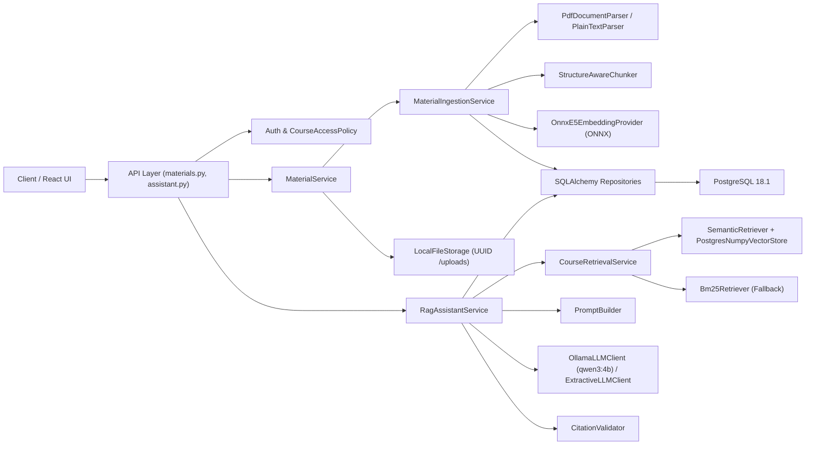
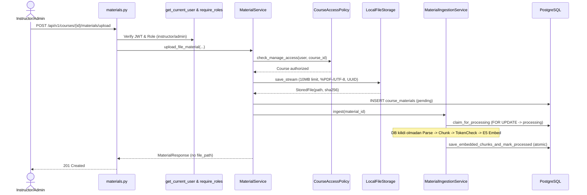
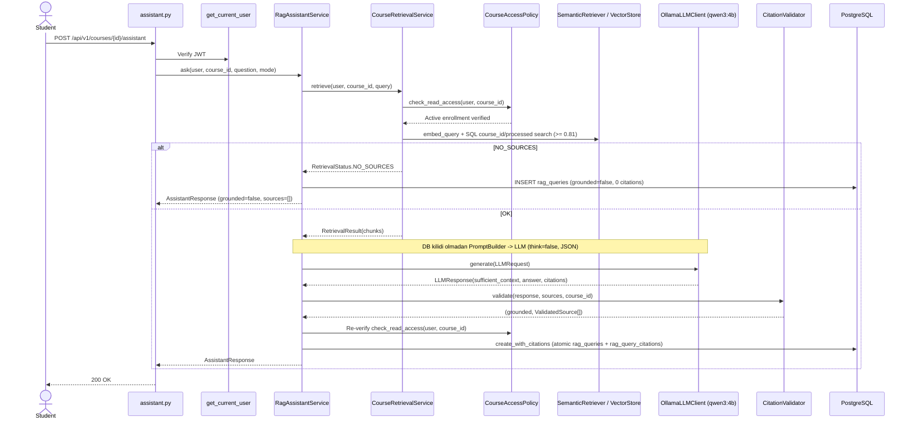
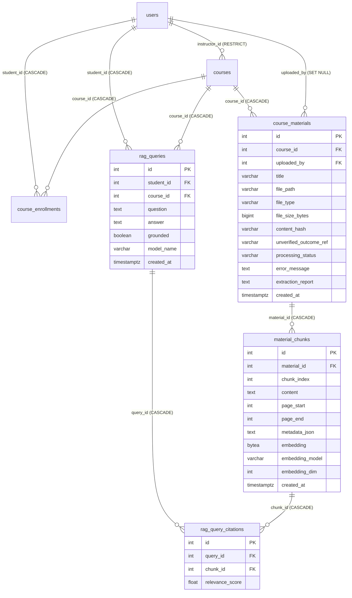

# StudyGraph AI — RAG Tabanlı Yapay Zekâ Asistanı Mimarisi (Issue #8)

> **Durum:** Backend RAG pipeline, servisler, API uçları ve otomatik testler tamamlandı (`feature/rag-system`). Canlı tarayıcı üzerinden React frontend entegrasyonu ekip çalışması kapsamında tamamlanacaktır.
> **Önemli Not:** Bu sistemde sıfırdan bir yapay zekâ modeli eğitilmemiştir. Mevcut açık ağırlıklı hazır modeller (`intfloat/multilingual-e5-small` ve Ollama üzerinden `qwen3:4b`) katmanlı yazılım mimarimize yerel ve değiştirilebilir bileşenler olarak entegre edilmiştir.

---

## 1. Amaç ve RAG Çalışma Mantığı

RAG (Retrieval-Augmented Generation) modülü, akademisyenlerin sisteme yüklediği ders materyallerini (PDF ve UTF-8 TXT) işleyerek öğrencilerin sorularına **yalnızca yetkili oldukları ders içeriğine dayalı, kaynak ve sayfa numarası gösteren** cevaplar üretir.

Sistem iki ana akıştan oluşur:
1. **Ingestion (İçerik Yükleme ve İndeksleme):** Dosya doğrulama → UUID depolama → `PdfDocumentParser` / `PlainTextParser` → `ExtractionReport` → `StructureAwareChunker` → `enforce_token_limit` → `OnnxE5EmbeddingProvider` (384 boyutlu L2-normalize float32 vektör) → PostgreSQL `material_chunks` (`BYTEA`) atomik kayıt.
2. **Query & Grounded Generation (Sorgulama ve Cevap Üretimi):** JWT kimlik doğrulama → `CourseAccessPolicy` yetki kontrolü → `CourseRetrievalService` (`SemanticRetriever` veya `Bm25Retriever`) → eşik üstü kaynak varsa `PromptBuilder` → `OllamaLLMClient` (`qwen3:4b`, `think: false`, yapılandırılmış JSON) → `CitationValidator` → ön-kayıt yetki doğrulaması → `RagQuery` ve `RagQueryCitation` atomik kayıt.

---

## 2. Katmanlı Mimari ve Gerçek Modül Yapısı

```text
backend/app/
├── api/
│   ├── materials.py                  # Canonical /api/v1 ve öneksiz uyumluluk materyal router'ları
│   ├── assistant.py                  # Canonical /api/v1 ve öneksiz uyumluluk asistan router'ları
│   └── dependencies/rag.py           # Lazy RAG DI sağlayıcıları ve sınırlı concurrency (BoundedSemaphore)
├── authorization/
│   └── course_access_policy.py       # CourseAccessPolicy (check_read_access, check_manage_access)
├── core/config.py                    # Lazy Settings (loopback Ollama, no-wildcard CORS, upload/PDF limitleri)
├── models/
│   ├── course.py                     # Course (Issue #7 & #8 ortak)
│   ├── course_enrollment.py          # CourseEnrollment, EnrollmentStatus (Issue #7 & #8 ortak)
│   ├── course_material.py            # CourseMaterial
│   ├── material_chunk.py             # MaterialChunk (embedding BYTEA, embedding_model, embedding_dim)
│   ├── rag_query.py                  # RagQuery
│   └── rag_query_citation.py         # RagQueryCitation
├── repositories/
│   ├── errors.py                     # Repository çatışma ve bütünlük hataları
│   ├── course_repository.py          # CourseRepository / SqlAlchemyCourseRepository
│   ├── course_enrollment_repository.py
│   ├── course_material_repository.py # claim_for_processing (FOR UPDATE) dahil
│   ├── material_chunk_repository.py  # save_embedded_chunks_and_mark_processed (atomik)
│   └── rag_query_repository.py       # create_with_citations (aynı ders doğrulamalı atomik kayıt)
├── storage/local_storage.py          # FileStorage Protocol / LocalFileStorage (UUID, streaming limit)
├── schemas/
│   ├── material.py                   # MaterialTextCreateRequest, MaterialResponse
│   └── assistant.py                  # AssistantRequest, AssistantSourceResponse, AssistantResponse
├── services/
│   ├── material_service.py           # MaterialService (CRUD + güvenli yükleme + orphan temizliği)
│   ├── material_ingestion_service.py # MaterialIngestionService
│   └── rag_assistant_service.py      # RagAssistantService
└── rag/
    ├── domain/types.py               # ProcessingStatus, BlockKind, DocumentBlock, ParsedPage,
    │                                 # ExtractionReport, ParsedDocument, ChunkDraft, CitationDraft,
    │                                 # RetrievedChunk, RetrievalMethod, RetrievalStatus, RetrievalResult
    ├── parsing/                      # DocumentParser, PdfDocumentParser (pdfplumber), PlainTextParser
    ├── chunking/                     # TextChunker, StructureAwareChunker
    ├── embedding/                    # EmbeddingProvider, OnnxE5EmbeddingProvider, validation, enforce_token_limit
    ├── vectorstore/                  # VectorStore, PostgresNumpyVectorStore
    ├── retrieval/                    # ChunkRetriever, SemanticRetriever, Bm25Retriever, CourseRetrievalService
    └── generation/                   # LLMClient, OllamaLLMClient, ExtractiveLLMClient, PromptBuilder, CitationValidator
```

*(Eski `backend/rag/pdf_loader.py` ve `backend/rag/text_splitter.py` prototipleri iş mantığını tekrarlamadan `app.rag.parsing` ve `app.rag.chunking` modüllerine yönlendiren ince uyumluluk sarmalayıcıları olarak korunmuştur.)*

---

## 3. Bileşen Sorumlulukları

- **Parsing (`PdfDocumentParser`, `PlainTextParser`):** `pdfplumber` (MIT) ile sayfa bazlı metin çıkarma, iki sütunlu okuma sırası sezgiseli, font/koordinat temelli başlık ve C/Python kod bloğu girinti koruma, boş/görsel/taranmış olabileceği düşünülen sayfa raporlaması (`ExtractionReport`). Şifreli (`EncryptedDocumentError`), bozuk (`InvalidDocumentError`) ve metinsiz (`EmptyDocumentError`) dosyaları kontrollü reddeder.
- **Chunking (`StructureAwareChunker`):** Başlık, paragraf, Türkçe/İngilizce cümle ve kod bloğu sınırlarını gözetir; uzun kod bloklarını yalnızca satır sınırlarından böler. `enforce_token_limit`, `multilingual-e5-small` tokenizer'ı ile 512-token sınırını aşan chunk'ları sessizce kesmeden yeniden böler.
- **Embedding (`OnnxE5EmbeddingProvider`):** Sabit revizyon (`614241f622f53c4eeff9890bdc4f31cfecc418b3`), MIT lisanslı `intfloat/multilingual-e5-small` fp32 ONNX modeli. Lazy yüklenir, `"passage: "` / `"query: "` öneklerini uygular, attention-mask mean pooling ve L2 normalizasyon ile 384 boyutlu vektör üretir.
- **VectorStore (`PostgresNumpyVectorStore`):** Vektörleri `BYTEA` (little-endian float32) saklar. SQL seviyesinde `course_id` ve `processing_status='processed'` filtresi uygular; model/boyut uyumu doğrular; NumPy ile kosinüs benzerliği hesaplar ve eşit skorlarda `(-score, chunk_id)` ile deterministik sıralar.
- **Retrieval (`CourseRetrievalService`, `SemanticRetriever`, `Bm25Retriever`):** Yetki kontrolünü (`CourseAccessPolicy`) embedding ve DB sorgusundan **önce** yapar. Varsayılan E5 eşiği ham kosinüs ölçeğinde `0.81`'dir. Saf Python Okapi BM25 yalnızca açık `ModelNotFoundError` durumunda veya açıkça seçildiğinde çalışır; yetki/DB hatalarında veya E5'in `NO_SOURCES` döndürdüğü durumda fallback yapılmaz.
- **Generation (`OllamaLLMClient`, `ExtractiveLLMClient`, `PromptBuilder`, `CitationValidator`, `RagAssistantService`):**
  - `OllamaLLMClient` yalnızca yerel loopback (`127.0.0.1`, `localhost`, `::1`) kabul eder, `qwen3:4b` (Apache-2.0, `Q4_K_M`) üzerinde `think: false` ve yapılandırılmış JSON `format` kullanır.
  - `PromptBuilder` üç mod (`explain`, `python_example`, `exercise`) ve `<course_materials untrusted_data="true">` ayrımı uygular.
  - `CitationValidator` sunucu üretimi `[S1]`..`[Sk]` kimliklerini doğrular; başlık ve sayfa bilgisini **yalnızca DB metadata'sından** alır; bilinmeyen veya başka derse ait kimlikleri reddeder.
  - `ExtractiveLLMClient` yalnızca LLM erişilemez veya doğrulama tekrar başarısız olursa devreye girer ve `[Yedek Çıkarımsal Mod]` uyarısını görünür biçimde ekler.
  - `RagAssistantService`, `NO_SOURCES` durumunda LLM çağırmadan `grounded=False` kaydeder; LLM çalışırken DB kilidi tutmaz; kayıt öncesi yetkiyi yeniden doğrular ve `RagQuery` + `RagQueryCitation` kayıtlarını tek transaction'da yazar.

---

## 4. UML ve Mimari Diyagramlar

### 4.1 RAG Component Diagram



### 4.2 Akademisyen Materyal Yükleme Sequence Diagram



### 4.3 Öğrenci RAG Asistanına Soru Sorma Sequence Diagram



### 4.4 RAG Temel Class Diagram

```mermaid
classDiagram
    class DocumentParser {
        <<Protocol>>
        +supported_file_types
        +parse(source, source_name) ParsedDocument
    }
    class PdfDocumentParser
    class PlainTextParser
    DocumentParser <|.. PdfDocumentParser
    DocumentParser <|.. PlainTextParser

    class TextChunker {
        <<Protocol>>
        +chunk(document) list~ChunkDraft~
    }
    class StructureAwareChunker
    TextChunker <|.. StructureAwareChunker

    class EmbeddingProvider {
        <<Protocol>>
        +model_name str
        +dimension int
        +max_tokens int
        +count_tokens(text, is_query) int
        +embed_documents(texts) list
        +embed_query(text) list
    }
    class OnnxE5EmbeddingProvider
    EmbeddingProvider <|.. OnnxE5EmbeddingProvider

    class VectorStore {
        <<Protocol>>
        +search(course_id, query_vector, expected_model, expected_dim, top_k) list~RetrievedChunk~
    }
    class PostgresNumpyVectorStore
    VectorStore <|.. PostgresNumpyVectorStore

    class ChunkRetriever {
        <<Protocol>>
        +method RetrievalMethod
        +retrieve(course_id, query, top_k, min_score) list~RetrievedChunk~
    }
    class SemanticRetriever
    class Bm25Retriever
    ChunkRetriever <|.. SemanticRetriever
    ChunkRetriever <|.. Bm25Retriever

    class LLMClient {
        <<Protocol>>
        +model_name str
        +generate(request) LLMResponse
    }
    class OllamaLLMClient
    class ExtractiveLLMClient
    LLMClient <|.. OllamaLLMClient
    LLMClient <|.. ExtractiveLLMClient

    class RagAssistantService {
        +ask(user, course_id, question, mode) AssistantAnswer
    }
    RagAssistantService --> CourseRetrievalService
    RagAssistantService --> PromptBuilder
    RagAssistantService --> LLMClient
    RagAssistantService --> CitationValidator
```



### 4.5 RAG Modüler ER Diagram



---

## 5. SOLID İlkeleri ve Tasarım Desenleri (Kod Örnekleriyle)

### 5.1 SOLID İlkeleri

| İlke | Dosya & Sınıf | Uygulama ve Gerekçe | Mevcut Sınırlama |
| --- | --- | --- | --- |
| **SRP** | `app/rag/parsing/pdf_parser.py` (`PdfDocumentParser`), `app/rag/chunking/structure_chunker.py` (`StructureAwareChunker`), `app/rag/generation/citation_validator.py` (`CitationValidator`) | PDF çözümleme, yapısal parçalama, embedding, retrieval, prompt üretimi ve kaynak doğrulama ayrı sınıflardadır. | `PdfDocumentParser` içindeki sütun/kod sezgiselleri ileride ayrı stratejilere bölünebilir. |
| **OCP** | `app/rag/embedding/protocol.py` (`EmbeddingProvider`), `app/rag/retrieval/protocol.py` (`ChunkRetriever`), `app/rag/generation/protocol.py` (`LLMClient`) | Mevcut servisler değiştirilmeden yeni embedding, retrieval veya LLM sağlayıcısı eklenebilir. | `api/dependencies/rag.py` sağlayıcı seçiminde fabrika koşulu barındırır. |
| **LSP** | `OllamaLLMClient` & `ExtractiveLLMClient`; `SemanticRetriever` & `Bm25Retriever` | Aynı `Protocol` sözleşmesini uygulayan her sınıf birbirinin yerine geçebilir. | `Bm25Retriever` ve `SemanticRetriever` skor ölçekleri farklıdır; eşik ayrı yapılandırılır. |
| **ISP** | `CourseRepository`, `CourseEnrollmentRepository`, `CourseMaterialRepository`, `MaterialChunkRepository`, `RagQueryRepository`, `Bm25CorpusRepository` | Her bileşen yalnızca ihtiyaç duyduğu küçük ve odaklı arayüze bağlıdır. | Yok. |
| **DIP** | `app/services/rag_assistant_service.py` (`RagAssistantService`), `app/services/material_ingestion_service.py` (`MaterialIngestionService`) | Servisler somut SQLAlchemy, ONNX veya Ollama sınıflarına değil, `Protocol` arayüzlerine bağımlıdır. | `CourseAccessPolicy` doğrudan `User`/`Course` ORM veri tiplerini okur (aktif proje standardıyla uyumlu). |

```python
# DIP & Strategy örneği — backend/app/services/rag_assistant_service.py
class RagAssistantService:
    def __init__(
        self,
        *,
        access_policy: CourseAccessPolicy,
        retrieval_service: CourseRetrievalService,
        prompt_builder: PromptBuilder,
        llm_client: LLMClient,                # Somut OllamaLLMClient değil, Protocol
        citation_validator: CitationValidator,
        query_repository: RagQueryRepository,  # Somut SQLAlchemy değil, Protocol
        extractive_fallback: ExtractiveLLMClient | None = None,
    ) -> None: ...
```

### 5.2 Kodda Gerçekten Uygulanan Tasarım Desenleri
- **Repository Pattern:** `app/repositories/*` — Tüm SQL sorguları ve transaction sınırları repository katmanında kapsüllenir.
- **Strategy Pattern:** `DocumentParser`, `TextChunker`, `EmbeddingProvider`, `ChunkRetriever`, `LLMClient` Protocol'leri ile çalışma zamanında strateji seçimi.
- **Dependency Injection:** FastAPI `Depends` (`app/api/dependencies/rag.py`) ve servis constructor enjeksiyonu.
- **Adapter / Facade Pattern:** `backend/rag/pdf_loader.py` ve `text_splitter.py` eski prototip arayüzlerini yeni `app.rag` sınıflarına uyarlar.
- **Service Layer:** `MaterialService`, `MaterialIngestionService`, `RagAssistantService` iş akışlarını HTTP katmanından ayırır.
- **Lazy Singleton (Thread-Safe):** `app/api/dependencies/rag.py` içinde ONNX model oturumunun süreç başına en fazla bir kez yüklenmesi.

---

## 6. Veri Güvenliği, Yetkilendirme ve Transaction Yönetimi

- **Kimlik ve Erişim:** Issue #6 `get_current_user` + `require_roles` + `CourseAccessPolicy` (deny-by-default). Yetkisiz veya olmayan derste `404`, rol uyumsuzluğunda `403`. Yetki kontrolü dosya okuma, embedding ve LLM çağrısından **önce** yapılır.
- **Yükleme Güvenliği:** `UploadBodyLimitMiddleware` (erken ASGI `Content-Length` + akışlı byte sınırı: `UPLOAD_MAX_BYTES + 512 KB`), 10 MB dosya sınırı (`413`), uzantı+MIME+`%PDF-`/UTF-8 imza (`415`/`422`), path traversal engeli, UUID dosya adları, `/uploads/` statik sunulmaz ve `.gitignore`'dadır. DB/ingestion hatasında orphan dosya silinir.
- **Veri Gizliliği:** `OllamaLLMClient` ve `Settings` yalnızca yerel loopback adresine (`127.0.0.1`, `localhost`, `::1`) izin verir; harici API'ye ders materyali gönderilmez.
- **Transaction ve Bağlantı Havuzu Yönetimi:** Uzun süren PDF parsing, ONNX embedding ve Ollama üretimi öncesinde `release_db_connection` (`db.close()`) ile SQLAlchemy havuz bağlantısı serbest bırakılır (`pool.checkedout() == 0` PostgreSQL entegrasyon testiyle doğrulanmıştır). `claim_for_processing` (kısa `FOR UPDATE`), `save_embedded_chunks_and_mark_processed` ve `create_with_citations` atomik transaction'lardır.
- **Test DB Güvenliği (G8):** `db_safety.py` içindeki `DEFAULT_ALLOWED_TABLES` bilinçli olarak değiştirilmemiştir; entegrasyon testleri her koşuda temiz ve geçici `--tmpfs` PostgreSQL 18.1 konteynerinde çalıştırılır (kalıcı test DB'de 2. koşuda G8 yeni tabloları reddeder).

---

## 7. Bilinen Sınırlamalar ve Açık Riskler (K73)

1. **OCR ve görsel yorumlama yok:** PDF görselleri ve diyagramları yalnızca `ExtractionReport` içinde raporlanır; içlerindeki metin okunmaz.
2. **Taranmış PDF'ler:** Metin katmanı olmayan taranmış sayfalar `suspected_scanned_pages` olarak uyarılır (kesin OCR sonucu değildir) ve tamamen metinsiz PDF'ler `failed` olur.
3. **Sezgisel düzen/kod tespiti:** Kod bloğu ve iki sütunlu okuma sırası font/koordinat sezgisellerine dayanır; her PDF için %100 garanti verilmez.
4. **E5 skor ölçeği ve eşik:** Ham cosine similarity bir doğruluk olasılığı değildir. `0.81` eşiği 25 etiketli sentetik sorguluk kalibrasyon çalışmasına dayanır; materyalde cevabı olmayan bazı CS soruları (`0.818–0.827`) ve tek kelimelik sorgular (`0.839`) eşiği geçebilir.
5. **LLM halüsinasyon ve citation sınırı:** `CitationValidator` yalnızca kaynak kimliği ve DB metadata bütünlüğünü doğrular; üretilen her cümlenin anlamsal olarak kaynak tarafından desteklendiğini (factual entailment) garanti etmez.
6. **Prompt injection:** Sistem talimatı ile `<course_materials untrusted_data="true">` ayrımı riski azaltır ancak %100 güvenlik garantisi vermez.
7. **Qwen3 4B gözlenen kusurlar:** Aşama 5 gerçek testlerinde (a) ilk C-pointer alıştırma testinde aynı konudaki injection eki nedeniyle modelin aşırı temkinli `grounded=False` döndürmesi, (b) Python kod örneğinde `[1, 2, .3, 4]` küçük yazım sapması ve (c) Türkçe alıştırma isteğine İngilizce yanıt eğilimi gözlemlenmiştir.
8. **Donanım, swap ve gecikme:** Apple M1 8 GB RAM'de E5 (~942 MB RSS) + Qwen3 4B (~3.2 GB Metal GPU) + PostgreSQL eşzamanlı çalışırken swap `~3.1–3.6 GB` düzeyine çıkmakta, soğuk ilk API yanıtı `~27.45 s` (sıcak yanıtlar `~6–15 s`) sürmektedir.
9. **Ölçeklenebilirlik:** `PostgresNumpyVectorStore` ders başına birkaç bin chunk için milisaniye düzeyindedir; çok büyük veri kümelerinde ileride `pgvector` gerekir.
10. **Doğrulanmamış `outcome_id`:** `learning_outcomes` tablosu henüz mevcut olmadığı için `unverified_outcome_ref` FK'siz saklanır ve yetkilendirmede kullanılmaz.
11. **Materyal silme ve yeniden indeksleme:** Materyal silindiğinde `ON DELETE CASCADE` ile geçmiş `rag_query_citations` satırları silinir; bu nedenle MVP'de `processed` materyallerin sessiz yeniden indekslenmesi engellenmiştir.
12. **Frontend canlı entegrasyon:** Öneksiz uyumluluk uçları otomatik API testleriyle doğrulanmıştır; ancak gerçek tarayıcı + React UI entegrasyonu henüz yapılmamıştır (`USE_MOCK=true`).

---

## 8. Sunum ve Demo Çalışma Rehberi (K74)

> **Ön Hazırlık (M1 8 GB RAM):** Demo öncesinde gereksiz tarayıcı sekmelerini ve ağır uygulamaları kapatın; `sysctl vm.swapusage` ile bellek durumunu kontrol edin.

1. **PostgreSQL ve Backend hazırlığı:** PostgreSQL'i başlatın, geliştirme veritabanında `alembic upgrade head` çalıştırın (`0001`→`0004`), ardından `backend/` içinde `uvicorn app.main:app --host 127.0.0.1 --port 8000` başlatın.
2. **Yerel Ollama başlatma:** `OLLAMA_HOST=127.0.0.1:11434 ~/.local/ollama/ollama serve` komutunu çalıştırın (yalnızca loopback).
3. **Model warm-up (soğuk yükleme gecikmesini önlemek için):** Sunumdan 1 dakika önce yerel Ollama'ya tek bir kısa `/api/chat` (`qwen3:4b`, `think: false`) isteği göndererek modeli GPU belleğine yükleyin (soğuk `~27 s` yerine sıcak `~6–10 s`).
4. **Akademisyen girişi:** `POST /api/v1/auth/login` ile akademisyen JWT token'ını alın.
5. **PDF yükleme:** `POST /api/v1/courses/{course_id}/materials/upload` ile telifsiz/sentetik C Pointers veya Python ders PDF'ini yükleyin.
6. **İşleme doğrulaması:** Yanıtta `processing_status: "processed"` ve `page_count` değerini gösterin.
7. **Öğrenci girişi:** `POST /api/v1/auth/login` ile derse aktif kaydı bulunan öğrenci JWT token'ını alın.
8. **Soru sorma:** `POST /api/v1/courses/{course_id}/assistant` ile konu anlatımı (`topic_explanation`), kod örneği (`code_example`) veya alıştırma (`exercise`) isteği gönderin.
9. **Kaynak gösterimi:** Yanıtta `grounded: true`, `answer` ve `sources[].title`, `sources[].page` alanlarını inceleyin.
10. **Yetkisiz erişim reddi:** Öğrencinin kayıtlı olmadığı başka bir `course_id` ile istek atarak `404 Not Found` yanıtını gösterin.
11. **Fallback senaryosu (Ollama kapalıysa):** Ollama durdurulduğunda asistanın `[Yedek Çıkarımsal Mod]` uyarısı ve `fallback_used: true` ile çalıştığını gösterin; yedek çıktıyı gerçek LLM cevabı olarak sunmayın.
