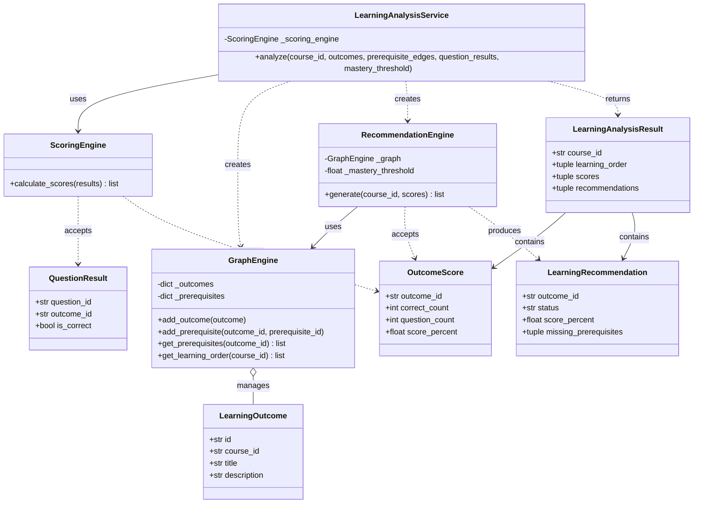

# StudyGraph AI — Backend UML Tasarımı

## 1. Amaç

Bu belge, StudyGraph AI projesinin Backend ve Öğrenme
Algoritmaları modülünde geliştirilen sınıfları ve
aralarındaki ilişkileri göstermektedir.

Ana sistemin UML tasarımı docs/UML_DIAGRAMS.md
dosyasında bulunmaktadır.

Bu belge, mevcut backend uygulamasının sınıf
seviyesindeki tasarımını açıklamak için hazırlanmıştır.

## 2. Backend Class Diagram

## 3. Sınıfların Sorumlulukları

### LearningOutcome
Bir derse ait öğrenme kazanımını temsil eder.
Kazanım kimliğini, ders kimliğini, başlığını ve
açıklamasını tutar.

### GraphEngine
Kazanımlar arasındaki yönlü ön koşul ilişkilerini
yönetir. Döngü kontrolü ve topolojik sıralama yapar.

### QuestionResult
Bir sınav sorusunun kazanımını ve doğru veya
yanlış değerlendirme sonucunu temsil eder.

### ScoringEngine
Sınav sonuçlarını kazanım bazında deterministik
olarak puanlar.

### OutcomeScore
Bir kazanımın doğru soru sayısını, toplam soru
sayısını ve başarı yüzdesini temsil eder.

### RecommendationEngine
Başarı puanları ve ön koşul ilişkilerini kullanarak
kişiselleştirilmiş öğrenme önerileri üretir.

### LearningRecommendation
Bir kazanıma ait öneri durumunu, başarı puanını
ve eksik ön koşullarını temsil eder.

### LearningAnalysisService
GraphEngine, ScoringEngine ve RecommendationEngine
bileşenlerini koordine eder.

### LearningAnalysisResult
Öğrenme sırasını, başarı puanlarını ve
önerileri tek sonuç nesnesinde toplar.

## 4. Mimari İlkeler

### Single Responsibility Principle
Her algoritma sınıfı kendi temel sorumluluğuna
odaklanmaktadır.

### Separation of Concerns
Domain, Application ve Presentation katmanları
birbirinden ayrılmıştır.

### Low Coupling
Öğrenme algoritmaları doğrudan FastAPI veya
veritabanı teknolojilerine bağımlı değildir.

### Dependency Injection
GraphEngine nesnesi RecommendationEngine'e
dışarıdan verilmektedir.

### Testability
Algoritmalar bağımsız birim testleriyle
doğrulanabilmektedir.

## 5. Gerçekleştirme Durumu

- GraphEngine: İlk sürüm geliştirildi.
- ScoringEngine: İlk sürüm geliştirildi.
- RecommendationEngine: İlk sürüm geliştirildi.
- LearningAnalysisService: Geliştirildi.
- FastAPI öğrenme analizi endpoint'i: Geliştirildi.
- Otomatik testler: 41 test başarılı.

## 6. Henüz Tamamlanmayan Entegrasyonlar

- PostgreSQL veritabanı bağlantısı
- Kullanıcı kimlik doğrulama ve yetkilendirme
- Sınav kayıt sistemiyle entegrasyon
- Frontend entegrasyonu
- RAG/LLM entegrasyonu

Bu diyagram mevcut backend kodunu temel almaktadır.
Sistemin diğer modülleri tamamlandıkça
entegrasyon ilişkileri güncellenecektir.
