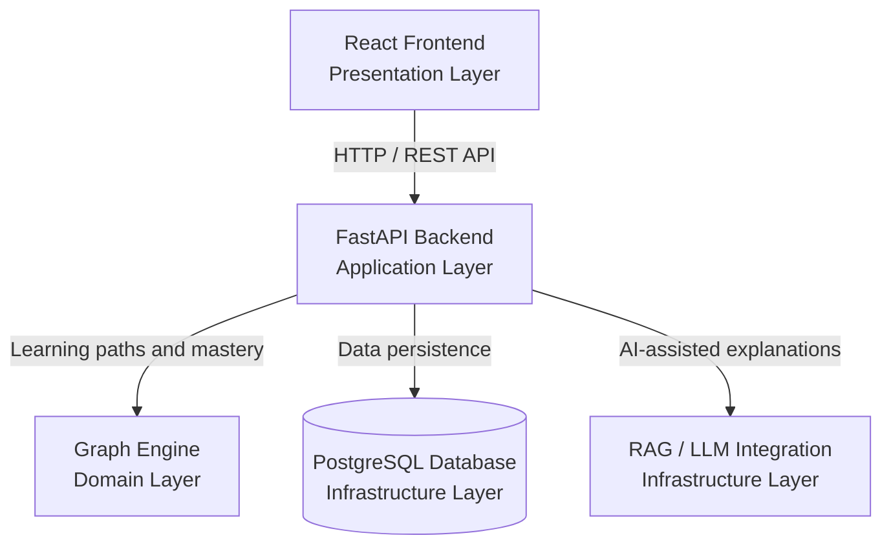
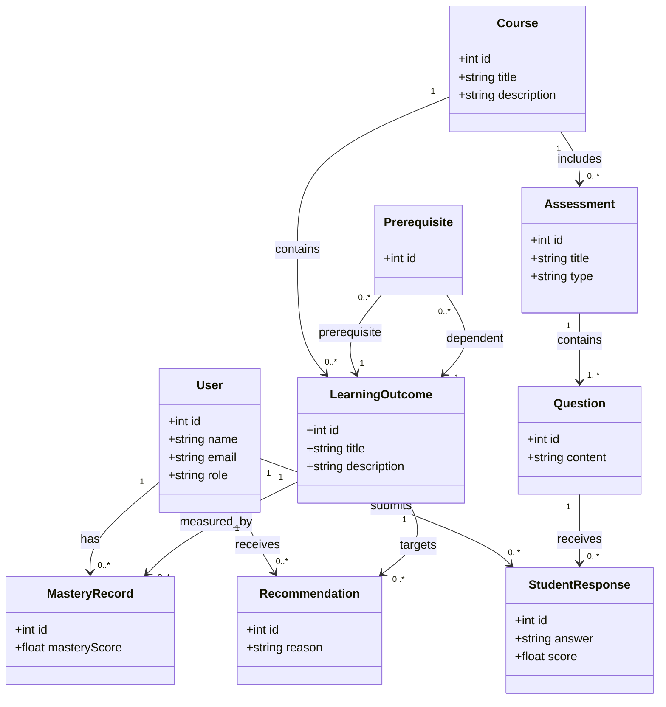
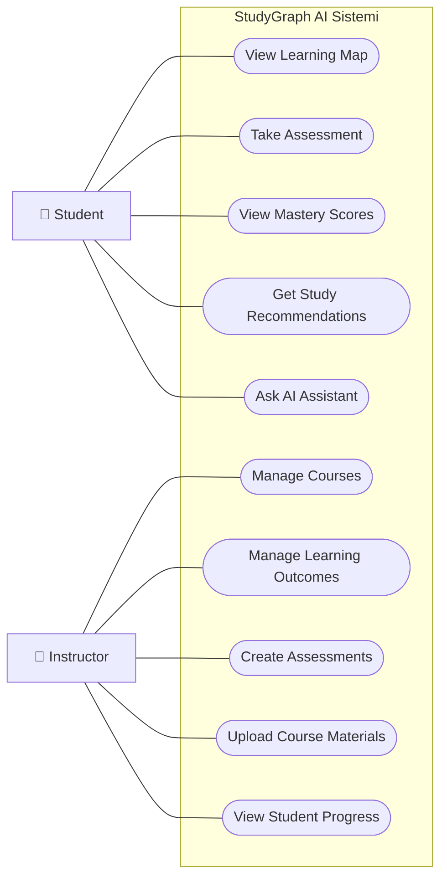

# StudyGraph AI — UML Diyagramları

## 1. Bileşen Diyagramı (Component Diagram)

Bu diyagram, StudyGraph AI sisteminin planlanan temel
bileşenlerini ve bu bileşenler arasındaki bağımlılıkları
göstermektedir.

### Bileşenlerin Görevleri

**React Frontend (Sunum Katmanı)**

Öğrenci ve öğretmenlerin sistemle etkileşim kurmasını sağlar. Kullanıcı panelleri, öğrenme haritaları ve değerlendirme ekranları bu bileşende yer alacaktır.

**FastAPI Backend (Uygulama Katmanı)**

Frontend tarafından gönderilen istekleri karşılar. Kullanıcı işlemlerini, değerlendirme süreçlerini ve diğer bileşenler arasındaki iletişimi yönetir.

**Graph Engine (Alan Katmanı)**

Öğrenme çıktıları arasındaki ön koşul ilişkilerini yöneten bileşendir. Öğrencinin hangi konuları öğrendiğini değerlendirerek kişiselleştirilmiş öğrenme yollarının oluşturulmasını destekler.

**PostgreSQL Database (Altyapı Katmanı)**

Kullanıcı bilgileri, dersler, öğrenme çıktıları, değerlendirmeler ve öğrencilerin öğrenme ilerlemeleri gibi verilerin saklanmasını sağlar.

**RAG / LLM Integration (Altyapı Katmanı)**

Öğretim elemanlarının sisteme yüklediği kaynaklardan yararlanarak öğrencilere yapay zekâ destekli açıklamalar sunulmasını amaçlar.

### Diyagramın Durumu

Bu diyagram, StudyGraph AI projesinin **planlanan mimarisini** göstermektedir. Bileşenler arasındaki bağlantılar ve teknik ayrıntılar geliştirme sürecinde netleştirilecektir.

## 2. Sınıf Diyagramı (Class Diagram)

Bu diyagram, StudyGraph AI sisteminin temel sınıflarını, bu sınıfların özelliklerini ve aralarındaki ilişkileri göstermektedir.

Sınıf diyagramının amacı, sistemin veri yapısını ve nesneler arasındaki bağlantıları geliştirme sürecinden önce planlamaktır.

### UML Sınıf Diyagramı

### Sınıfların Görevleri

**User (Kullanıcı):** Sisteme kayıtlı öğrenci ve öğretmenleri temsil eder. Kullanıcının kimlik, iletişim ve rol bilgilerini içerir.

**Course (Ders):** Sistemde bulunan dersleri temsil eder. Her dersin kendisine ait öğrenme çıktıları ve değerlendirmeleri olabilir.

**LearningOutcome (Öğrenme Çıktısı):** Öğrencinin bir ders kapsamında kazanması beklenen bilgi veya beceriyi temsil eder.

**Prerequisite (Ön Koşul):** Öğrenme çıktıları arasındaki ön koşul ilişkisini temsil eder. Örneğin, türev konusunu öğrenmeden önce fonksiyonlar konusunun bilinmesi gerekebilir.

**Assessment (Değerlendirme):** Öğrencinin bilgi düzeyini ölçmek amacıyla hazırlanan sınav veya değerlendirme etkinliğidir.

**Question (Soru):** Değerlendirmelerde öğrencilere yöneltilen soruları temsil eder.

**StudentResponse (Öğrenci Cevabı):** Öğrencinin bir soruya verdiği cevabı ve bu cevap sonucunda elde ettiği puanı saklar.

**MasteryRecord (Yeterlilik Kaydı):** Öğrencinin belirli bir öğrenme çıktısındaki yeterlilik düzeyini takip eder.

**Recommendation (Öneri):** Öğrencinin mevcut öğrenme durumuna göre sistem tarafından oluşturulan çalışma önerilerini temsil eder.

### Sınıflar Arasındaki İlişkiler

- **Course – LearningOutcome:** Bir ders, birden fazla öğrenme çıktısı içerebilir. Her öğrenme çıktısı bir derse bağlıdır.
- **Course – Assessment:** Bir ders kapsamında birden fazla değerlendirme oluşturulabilir.
- **Assessment – Question:** Bir değerlendirme en az bir sorudan oluşur.
- **User – StudentResponse:** Bir öğrenci farklı sorulara birden fazla cevap verebilir.
- **Question – StudentResponse:** Bir soruya farklı öğrenciler tarafından birden fazla cevap verilebilir.
- **User – MasteryRecord:** Her öğrencinin öğrenme çıktılarındaki yeterlilik düzeyleri ayrı ayrı takip edilir.
- **LearningOutcome – MasteryRecord:** Bir öğrenme çıktısı için farklı öğrencilerin yeterlilik kayıtları bulunabilir.
- **User – Recommendation:** Bir öğrenciye birden fazla kişiselleştirilmiş çalışma önerisi sunulabilir.
- **LearningOutcome – Recommendation:** Öneriler belirli öğrenme çıktılarını hedefleyebilir.
- **Prerequisite – LearningOutcome:** Bir ön koşul ilişkisi, öğrenilmesi gereken çıktı ile bu çıktıya bağlı olan diğer öğrenme çıktısını birbirine bağlar.

### UML Çokluk (Multiplicity) Kavramı

UML sınıf diyagramlarında çokluk, bir sınıfa ait nesnenin başka bir sınıftan kaç nesneyle ilişki kurabileceğini gösterir.

- **1:** Tam olarak bir nesne.
- **0..\*:** Sıfır veya daha fazla nesne.
- **1..\*:** Bir veya daha fazla nesne.

**Örnek:** Bir `Course` nesnesi birden fazla `LearningOutcome` nesnesine sahip olabilir. Ancak her `LearningOutcome` nesnesi yalnızca bir `Course` nesnesine bağlıdır.

### Tasarım Kararları

StudyGraph AI sisteminde sınıfların ayrı sorumluluklara sahip olacak şekilde tasarlanması hedeflenmektedir. Bu yaklaşım, SOLID ilkelerinden **Single Responsibility Principle (SRP)** ile uyumludur.

Öğrenci yeterlilik bilgilerinin `MasteryRecord`, çalışma önerilerinin ise `Recommendation` sınıfında tutulması, farklı işlevlerin birbirinden ayrılmasını sağlar.

Öğrenme çıktıları arasındaki ön koşul ilişkilerinin ayrı bir `Prerequisite` sınıfıyla modellenmesi, yönlü bir öğrenme grafiğinin oluşturulmasını destekler.

### Diyagramın Durumu

Bu diyagram, StudyGraph AI projesinin planlanan alan modelini göstermektedir. Sınıflar, özellikler ve ilişkiler geliştirme sürecinde ihtiyaçlara göre güncellenebilir.

## 3. Kullanım Senaryosu Diyagramı (Use Case Diagram)

Bu diyagram, StudyGraph AI sisteminin kullanıcı rollerini ve bu rollerin gerçekleştirebileceği temel işlemleri göstermektedir.

Sistemde iki temel kullanıcı rolü planlanmaktadır:

- **Student (Öğrenci):** Kendi öğrenme sürecini takip eden, değerlendirmelere katılan ve kişiselleştirilmiş öneriler alan kullanıcıdır.
- **Instructor (Öğretim Elemanı):** Ders içeriklerini, öğrenme çıktılarını ve değerlendirmeleri yöneten kullanıcıdır.

### Kullanım Senaryosu Diyagramı

_Not: Mermaid ile hazırlanan bu şema, kullanım senaryolarını gösteren bir taslak görselleştirmedir. Standart UML Use Case gösterimindeki aktör sembolleri ve sistem sınırı daha sonra özel bir UML aracıyla düzenlenebilir._

### Öğrenci Kullanım Senaryoları

**View Learning Map (Öğrenme Haritasını Görüntüleme):** Öğrenci, öğrenme çıktıları arasındaki ön koşul ilişkilerini görsel bir harita üzerinden inceleyebilir.

**Take Assessment (Değerlendirmeye Katılma):** Öğrenci, mevcut bilgi düzeyini belirlemek veya ilerlemesini ölçmek amacıyla değerlendirmelere katılabilir.

**View Mastery Scores (Yeterlilik Puanlarını Görüntüleme):** Öğrenci, öğrenme çıktılarındaki yeterlilik düzeylerini takip edebilir.

**Get Study Recommendations (Çalışma Önerileri Alma):** Sistem, öğrencinin eksik olduğu konuları ve ön koşul ilişkilerini dikkate alarak kişiselleştirilmiş çalışma önerileri sunmayı hedefler.

**Ask AI Assistant (Yapay Zekâ Asistanına Soru Sorma):** Öğrenci, ders konularıyla ilgili sorular sorarak öğretim elemanının yüklediği kaynaklara dayalı açıklamalar alabilir.

### Öğretim Elemanı Kullanım Senaryoları

**Manage Courses (Dersleri Yönetme):** Öğretim elemanı ders bilgilerini oluşturabilir ve düzenleyebilir.

**Manage Learning Outcomes (Öğrenme Çıktılarını Yönetme):** Derslere ait öğrenme çıktılarını ve aralarındaki ön koşul ilişkilerini tanımlayabilir.

**Create Assessments (Değerlendirme Oluşturma):** Öğrencilerin bilgi düzeylerini ölçmek amacıyla sorular ve değerlendirmeler hazırlayabilir.

**Upload Course Materials (Ders Materyali Yükleme):** Yapay zekâ asistanının yararlanması amacıyla ders notlarını ve diğer kaynakları sisteme yükleyebilir.

**View Student Progress (Öğrenci İlerlemesini Görüntüleme):** Öğrencilerin değerlendirme sonuçlarını ve öğrenme çıktılarındaki ilerlemelerini takip edebilir.

### Tasarımın Amacı

Öğrenci ve öğretim elemanı rollerinin ayrılması, kullanıcıların yalnızca kendi yetkileri kapsamındaki işlemleri gerçekleştirmesini hedefler.

Bu yaklaşım, sistemin kullanıcı ihtiyaçlarına göre tasarlanmasını ve rol bazlı yetkilendirme gereksinimlerinin belirlenmesini kolaylaştırır.

### Diyagramın Durumu

Bu diyagram planlanan kullanım senaryolarını göstermektedir. Kullanıcı yetkileri ve iş akışları geliştirme sürecinde netleştirilecektir.
